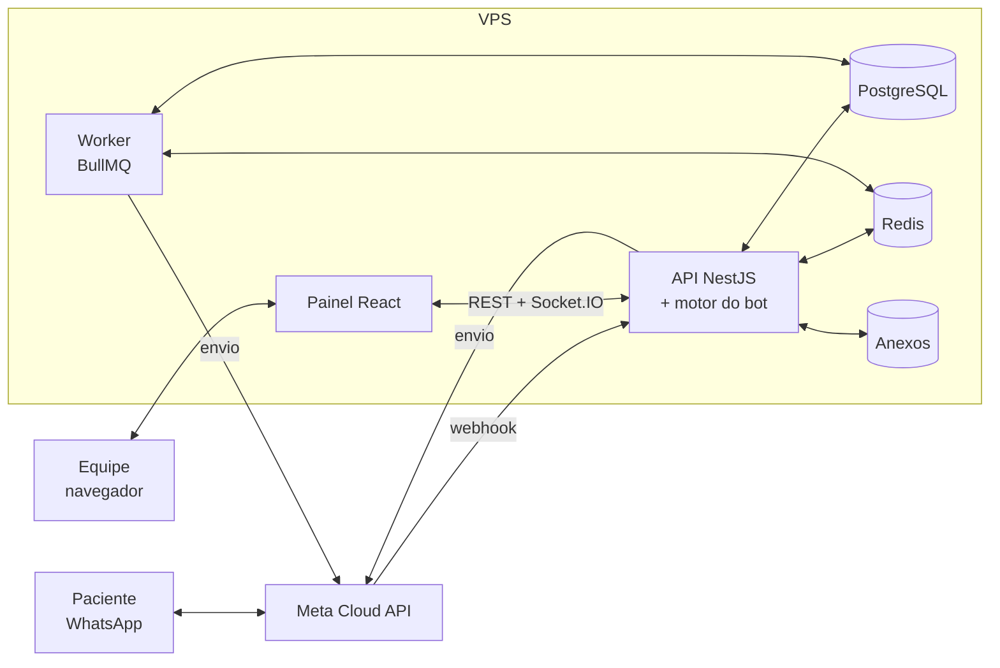
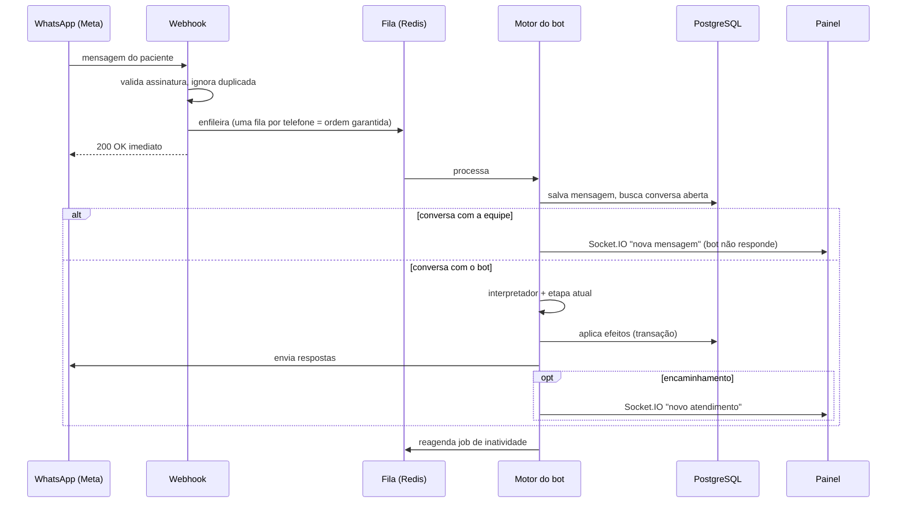

# Arquitetura e Estrutura de Código (proposta)

Planejamento – nada implementado ainda. Ver [`REQUISITOS.md`](REQUISITOS.md)
e [`BANCO_DE_DADOS.md`](BANCO_DE_DADOS.md).

---

## 1. Stack sugerida

| Camada | Escolha | Por quê |
|---|---|---|
| Linguagem | **TypeScript** (Node.js 22) | Uma linguagem no back e no front; tipos compartilhados |
| API | **NestJS** | Módulos bem separados, injeção de dependência, fácil de testar |
| Banco | **PostgreSQL 16** | Ver `BANCO_DE_DADOS.md` |
| ORM / migrações | **Prisma** | Schema versionado, migrações automáticas |
| Filas e agendamentos | **Redis + BullMQ** | Lembretes, travas de tempo, disparo em lote com limite de envio |
| Tempo real | **Socket.IO** | Notificar a equipe e atualizar o chat sem recarregar |
| Front-end | **React + Vite**, TanStack Query, componente de calendário (FullCalendar) | Painel web |
| WhatsApp | **WhatsApp Business Cloud API (Meta)** | Oficial, sem risco de bloqueio; suporta botões, listas e templates |
| Anexos | Armazenamento privado em disco da VPS (ou S3 compatível) | Exames e documentos – nunca públicos |
| Deploy | **Docker Compose** + Nginx (HTTPS) na VPS | Sobe tudo com um comando; mesmo setup em teste e produção |

Alternativa para o canal: uma camada de **provedor** (seção 4.3) permite
trocar a Cloud API por outro provedor sem mexer no bot.

---

## 2. Visão geral



- **API**: recebe o webhook do WhatsApp, executa o bot, atende o painel.
- **Worker**: processa jobs com hora marcada (lembretes, não resposta,
  encerramento por inatividade) e o disparo em lote. Mesmo código da API,
  outro processo.

---

## 3. Estrutura de pastas (monorepo)

```
procape-saude-digital/
├── apps/
│   ├── api/                          # back-end NestJS
│   │   ├── prisma/
│   │   │   ├── schema.prisma         # modelo de BANCO_DE_DADOS.md
│   │   │   ├── migrations/
│   │   │   └── seed.ts               # dados FICTÍCIOS para teste
│   │   └── src/
│   │       ├── main.ts               # sobe a API
│   │       ├── worker.ts             # sobe o worker (jobs)
│   │       ├── config/               # variáveis de ambiente validadas
│   │       ├── common/               # guards, filtros de erro, paginação, utils (CPF, telefone, datas)
│   │       ├── modules/
│   │       │   ├── auth/             # login, JWT, perfis
│   │       │   ├── usuarios/
│   │       │   ├── equipes/
│   │       │   ├── servicos/
│   │       │   ├── pacientes/        # cadastro, telefones, busca, importação de planilha, linha do tempo
│   │       │   ├── prontuario/       # dados de abertura, status do prontuário
│   │       │   ├── agendas/          # disponibilidade (agenda_horarios), reserva com lock
│   │       │   ├── agendamentos/     # CRUD, transições de status, eventos
│   │       │   ├── campanhas/        # disparo em lote
│   │       │   ├── conversas/        # conversas, mensagens, anexos, chat da equipe
│   │       │   ├── atendimentos/     # fila humana
│   │       │   ├── pendencias/
│   │       │   ├── notificacoes/     # gateway Socket.IO
│   │       │   ├── modelos-mensagem/
│   │       │   ├── configuracoes/
│   │       │   └── auditoria/        # interceptor que registra acessos/alterações
│   │       ├── whatsapp/
│   │       │   ├── whatsapp.provider.ts      # interface: enviarTexto, enviarBotoes, enviarLista, enviarTemplate, baixarMidia
│   │       │   ├── meta-cloud.provider.ts    # implementação Cloud API
│   │       │   ├── fake.provider.ts          # simulador para testes/desenvolvimento
│   │       │   └── webhook.controller.ts     # verifica assinatura, deduplica por whatsapp_id, enfileira
│   │       ├── bot/
│   │       │   ├── motor.ts                  # carrega conversa → chama etapa → aplica efeitos
│   │       │   ├── tipos.ts                  # Etapa, Entrada, Resultado, Efeito
│   │       │   ├── interpretador.ts          # normaliza resposta: número, botão, palavras-chave ("atendente", "cancelar")
│   │       │   ├── fluxos/
│   │       │   │   ├── inicio.ts             # aviso LGPD + identificação pelo número
│   │       │   │   ├── identificacao.ts      # CPF/Cartão SUS + data de nascimento, troca de telefone
│   │       │   │   ├── servico.ts            # qual serviço
│   │       │   │   ├── menu.ts               # 5 opções
│   │       │   │   ├── agendamento.ts        # coleta, prontuário, horários, reserva
│   │       │   │   ├── prontuario.ts         # coleta de dados para abertura
│   │       │   │   ├── confirmacao.ts        # resposta 1/2/3 da mensagem de agendamento
│   │       │   │   ├── remarcacao.ts
│   │       │   │   ├── cancelamento.ts
│   │       │   │   ├── primeiro-contato.ts   # pré-cateterismo (exames + dados)
│   │       │   │   └── encaminhamento.ts     # falar com a equipe / automático
│   │       │   └── textos/                   # textos fixos do bot (fora do código de fluxo)
│   │       └── jobs/
│   │           ├── nao-resposta.job.ts       # lembrete +24h, marca sem_resposta +48h
│   │           ├── lembrete-consulta.job.ts
│   │           ├── inatividade.job.ts        # encerra conversas (bot X min, equipe 30 min)
│   │           └── disparo-campanha.job.ts   # envio em lote respeitando limite da Meta
│   │
│   └── web/                          # painel React
│       └── src/
│           ├── api/                  # cliente HTTP + hooks TanStack Query
│           ├── socket/               # conexão Socket.IO
│           ├── components/           # tabela, filtros, StatusBadge (cores), Timeline, ChatBox
│           └── pages/
│               ├── Login/
│               ├── Pacientes/        # lista com cores/filtros
│               ├── PacienteDetalhe/  # dados, agendamentos, linha do tempo, pendências, conversa
│               ├── Fila/             # atendimentos humanos por equipe
│               ├── Chat/             # conversa em atendimento
│               ├── Agenda/           # calendário + disponibilidade
│               ├── Campanhas/        # importação e disparo em lote
│               ├── Pendencias/
│               └── Configuracoes/    # serviços, modelos de mensagem, prazos, usuários
│
├── packages/
│   └── shared/                       # enums e tipos usados por api e web (status, cores, motivos)
│
├── docker-compose.yml                # postgres, redis, api, worker, web, nginx
├── .env.example
└── docs/                             # estes documentos
```

---

## 4. Desenho do bot

### 4.1 Máquina de estados
Cada conversa guarda `etapa_fluxo` e `dados_coletados`. Cada etapa é uma
função **pura**: recebe a entrada e o contexto e devolve o que responder, a
próxima etapa e os efeitos no banco. Isso deixa o fluxo testável sem
WhatsApp.

```ts
// esboço – não implementado
type Resultado = {
  respostas: MensagemSaida[];          // o que enviar ao paciente
  proximaEtapa: string | null;         // null = fim do fluxo
  dados?: Partial<DadosColetados>;     // salvar em conversas.dados_coletados
  efeitos?: Efeito[];                  // criar agendamento, abrir atendimento, pendência…
};

type Etapa = (entrada: Entrada, ctx: Contexto) => Promise<Resultado>;
```

Efeitos são aplicados pelo motor numa **transação** (ex.: reservar horário +
criar agendamento + registrar evento + agendar lembrete).

### 4.2 Processamento de uma mensagem recebida



### 4.3 Regras transversais (no motor, não em cada fluxo)
- Palavras como "atendente", "humano", "equipe" → encaminhamento em
  qualquer etapa.
- Palavras de urgência (configuráveis) → prioridade `urgente` +
  encaminhamento.
- Resposta não entendida → repete a pergunta; na 2ª vez, encaminha
  (`nao_entendido`).
- Ação sensível exige `identidade_validada`.
- O bot nunca envia dados pessoais; mensagens só com primeiro nome, data,
  hora e link.
- Antes de enviar texto livre, verifica a janela de 24h; fora dela usa
  template.

### 4.4 Rotina de "não resposta" (jobs)
Ao enviar uma confirmação: cria job `lembrete_sem_resposta` para +24h.
Se o paciente responder, o job é cancelado. Se executar: envia o lembrete e
cria `marcar_sem_resposta` para +24h → status `sem_resposta` (🔵), pendência
`ligar_sem_resposta` e notificação para a equipe.

---

## 5. API REST (principais rotas)

| Recurso | Rotas |
|---|---|
| Auth | `POST /auth/login`, `GET /auth/me` |
| Pacientes | `GET /pacientes?busca=&servico=&status=&naoAtendidos=`, `POST /pacientes`, `GET/PATCH /pacientes/:id`, `GET /pacientes/:id/linha-do-tempo`, `POST /pacientes/importar` (planilha) |
| Telefones | `POST /pacientes/:id/telefones`, `POST /telefones/:id/validar` |
| Prontuário | `PUT /pacientes/:id/dados-prontuario`, `POST /pacientes/:id/prontuario` (registrar nº → retoma fluxo) |
| Agendamentos | `GET /agendamentos?de=&ate=&status=`, `POST /pacientes/:id/agendamentos` (envia confirmação), `PATCH /agendamentos/:id`, `POST /agendamentos/:id/remarcar`, `POST /agendamentos/:id/cancelar` |
| Agendas | `GET /agendas/:id/horarios?de=&ate=`, `POST /agendas/:id/horarios/gerar` (lote), `PATCH /horarios/:id` |
| Campanhas | `POST /campanhas`, `POST /campanhas/:id/enviar`, `GET /campanhas/:id` |
| Fila | `GET /atendimentos?equipe=&status=`, `POST /atendimentos/:id/assumir`, `POST /atendimentos/:id/resolver` |
| Conversas | `GET /conversas/:id/mensagens`, `POST /conversas/:id/mensagens` (equipe envia), `POST /conversas/:id/encerrar`, `POST /conversas/:id/devolver-ao-bot` |
| Pendências | `GET /pendencias`, `PATCH /pendencias/:id` |
| Config | `GET/PUT /configuracoes`, CRUD `/servicos`, `/modelos-mensagem`, `/usuarios`, `/equipes` |
| WhatsApp | `GET /webhooks/whatsapp` (verificação Meta), `POST /webhooks/whatsapp` |

Eventos Socket.IO: `atendimento.novo`, `atendimento.atualizado`,
`mensagem.nova`, `agendamento.status`, `pendencia.nova`.

---

## 6. Segurança e LGPD
- HTTPS obrigatório; JWT de curta duração; senhas com argon2.
- Autorização por perfil e por equipe (atendente só vê as filas das suas
  equipes).
- Auditoria de visualização e alteração de pacientes.
- Assinatura do webhook da Meta validada (`X-Hub-Signature-256`).
- Anexos fora da pasta pública, servidos só para usuário autenticado.
- Backup diário do PostgreSQL criptografado, fora da VPS.
- Ambiente de teste com **dados fictícios** (seed) e número de WhatsApp de
  teste; nenhum dado real fora da VPS oficial.

---

## 7. Testes
- **Unitários** nas etapas do bot (funções puras): cada caminho dos fluxos
  da seção 4 de `REQUISITOS.md` vira um teste.
- **Simulador de conversa** com o `fake.provider` para a Anna testar os
  fluxos sem WhatsApp real.
- **Integração** da API com banco de teste (reserva concorrente de horário,
  transições de status, jobs de não resposta).

---

## 8. Plano de entrega (~20 dias)

| Etapa | Dias | Entregas |
|---|---|---|
| 0. Preparação | antes | VPS, conta Meta Business + número de teste, textos dos templates enviados para aprovação |
| 1. Base | 1–3 | Monorepo, Docker Compose, schema e migrações, auth, seed fictício |
| 2. Cadastro e agenda | 3–5 | Pacientes, serviços, agendamentos, lista com cores/filtros, importação |
| 3. WhatsApp + bot MVP | 5–8 | Webhook, provedor, confirmação 1/2/3, encaminhamento, fila, chat, notificações |
| 4. Jobs | 8–10 | Não resposta, lembretes, travas de tempo, disparo em lote |
| 5. Testes com a equipe | 11–20 | Testes da Anna, ajustes; em paralelo: identificação completa, menu, prontuário, linha do tempo |
| Depois | – | Disponibilidade/autoagendamento, remarcação automática, IA na triagem |

**Dependência crítica**: aprovação dos templates pela Meta e verificação da
conta Business podem levar dias – precisam começar antes do desenvolvimento.
