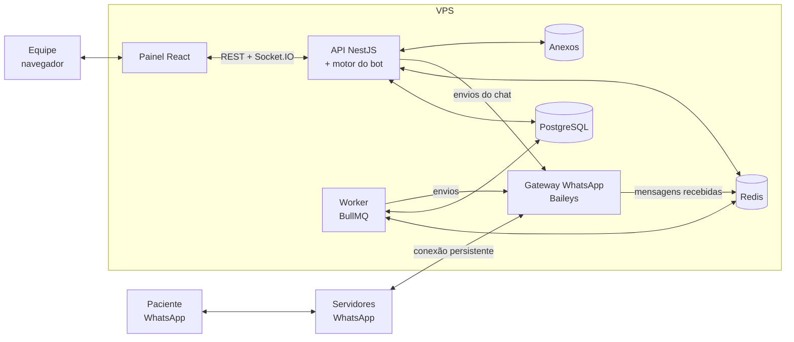
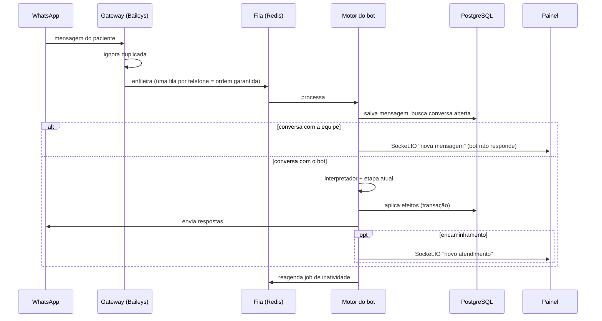

# Arquitetura e Estrutura de Código (proposta)

Planejamento – nada implementado ainda. Ver [`REQUISITOS.md`](REQUISITOS.md),
[`BANCO_DE_DADOS.md`](BANCO_DE_DADOS.md) e [`MENSAGENS.md`](MENSAGENS.md).

---

## 1. Stack sugerida

| Camada | Escolha | Por quê |
|---|---|---|
| Linguagem | **TypeScript** (Node.js 22) | Uma linguagem no back e no front; tipos compartilhados |
| API | **NestJS** | Módulos bem separados, injeção de dependência, fácil de testar |
| Banco | **PostgreSQL 16** | Ver `BANCO_DE_DADOS.md` |
| ORM / migrações | **Prisma** | Schema versionado, migrações automáticas |
| Filas e agendamentos | **Redis + BullMQ** | Lembretes, travas de tempo, disparo em lote com limite de envio |
| Tempo real | **Socket.IO** | Notificar a equipe e atualizar o chat sem recarregar |
| Front-end | **React + Vite**, TanStack Query, componente de calendário (FullCalendar) | Painel web |
| WhatsApp | **Baileys** (`@whiskeysockets/baileys`, versão fixada) | Decisão da equipe: sem custo e sem aprovação de modelos. Não oficial – riscos e mitigações em `REQUISITOS.md`, seção 6 |
| Anexos | Armazenamento privado em disco da VPS (ou S3 compatível) | Exames e documentos – nunca públicos |
| Deploy | **Docker Compose** + Nginx (HTTPS) na VPS | Sobe tudo com um comando; mesmo setup em teste e produção |

O bot fala com o WhatsApp por uma camada de **provedor**: se o número for
bloqueado ou o hospital migrar para a API oficial da Meta, troca-se só essa
camada, sem mexer no bot.

---

## 2. Visão geral



- **Gateway WhatsApp**: processo único que mantém a conexão do Baileys
  (um número = uma conexão), publica as mensagens recebidas na fila e
  executa os envios com cadência. Reconecta sozinho; se precisar de QR code,
  avisa a Supervisão.
- **API**: consome as mensagens recebidas, executa o bot, atende o painel.
- **Worker**: processa jobs com hora marcada (lembretes, não resposta,
  encerramento por inatividade) e o disparo em lote. Mesmo código da API,
  outro processo.

---

## 3. Estrutura de pastas (monorepo)

```
procape-saude-digital/
├── apps/
│   ├── api/                          # back-end NestJS
│   │   ├── prisma/
│   │   │   ├── schema.prisma         # modelo de BANCO_DE_DADOS.md
│   │   │   ├── migrations/
│   │   │   └── seed.ts               # dados FICTÍCIOS para teste
│   │   └── src/
│   │       ├── main.ts               # sobe a API
│   │       ├── worker.ts             # sobe o worker (jobs)
│   │       ├── config/               # variáveis de ambiente validadas
│   │       ├── common/               # guards, filtros de erro, paginação, utils (CPF, telefone, datas)
│   │       ├── modules/
│   │       │   ├── auth/             # login, JWT, 2FA, guard de permissões e escopo por equipe
│   │       │   ├── perfis/           # níveis de acesso e matriz de permissões
│   │       │   ├── usuarios/
│   │       │   ├── equipes/
│   │       │   ├── servicos/
│   │       │   ├── pacientes/        # cadastro, telefones, busca, importação de planilha, linha do tempo
│   │       │   ├── agenda/           # calendário e sugestão de data (regra do pré-cateterismo)
│   │       │   ├── agendamentos/     # CRUD, transições de status, eventos
│   │       │   ├── campanhas/        # disparo em lote
│   │       │   ├── conversas/        # conversas, mensagens, anexos, chat da equipe
│   │       │   ├── atendimentos/     # fila humana
│   │       │   ├── pendencias/
│   │       │   ├── notificacoes/     # gateway Socket.IO
│   │       │   ├── modelos-mensagem/ # textos editáveis, opções numeradas, variáveis
│   │       │   ├── comunicacoes/     # registro de envios, lembretes e respostas
│   │       │   ├── orientacoes/      # respostas cadastradas que o bot pode dar
│   │       │   ├── formularios/      # formulários de avaliação por serviço
│   │       │   ├── horarios/         # expediente e feriados
│   │       │   ├── relatorios/
│   │       │   ├── configuracoes/
│   │       │   └── auditoria/        # interceptor que registra acessos/alterações
│   │       ├── whatsapp/
│   │       │   ├── whatsapp.provider.ts      # interface: enviarTexto, enviarMidia, baixarMidia, status
│   │       │   ├── baileys.provider.ts       # implementação Baileys (gateway: conexão, QR, reconexão, cadência)
│   │       │   ├── sessao-criptografada.ts   # guarda as credenciais do Baileys criptografadas no banco
│   │       │   ├── fake.provider.ts          # simulador para testes/desenvolvimento
│   │       │   └── recebimento.ts            # deduplica por whatsapp_id e enfileira por telefone
│   │       ├── bot/
│   │       │   ├── motor.ts                  # carrega conversa → chama etapa → aplica efeitos
│   │       │   ├── tipos.ts                  # Etapa, Entrada, Resultado, Efeito
│   │       │   ├── interpretador.ts          # normaliza resposta: número da opção ou palavras-chave ("atendente", "cancelar")
│   │       │   ├── fluxos/
│   │       │   │   ├── inicio.ts             # aviso LGPD + identificação pelo número
│   │       │   │   ├── identificacao.ts      # CPF + data de nascimento, troca de telefone
│   │       │   │   ├── servico.ts            # qual serviço
│   │       │   │   ├── menu.ts               # 6 opções (lista)
│   │       │   │   ├── solicitacao.ts        # coleta dados, prontuário opcional, registra pedido p/ equipe
│   │       │   │   ├── confirmacao.ts        # resposta 1/2/3 da mensagem de agendamento
│   │       │   │   ├── remarcacao.ts         # pergunta preferência de período e encaminha à equipe
│   │       │   │   ├── cancelamento.ts
│   │       │   │   ├── primeiro-contato.ts   # pré-cateterismo (exames + dados)
│   │       │   │   ├── confirmacao-presenca.ts # Confirmo / Preciso remarcar / Cancelar
│   │       │   │   ├── orientacoes.ts        # lista e busca nas orientações cadastradas
│   │       │   │   ├── pendencia-paciente.ts # recebe documento pedido na msg 8.3
│   │       │   │   └── encaminhamento.ts     # falar com a equipe / automático / fora do horário
│   │       │   └── textos/                   # só textos de fallback; os oficiais vêm de modelos_mensagem
│   │       └── jobs/
│   │           ├── nao-resposta.job.ts       # lembrete 1, lembrete 2, depois encaminha
│   │           ├── envio-link.job.ts         # link da teleconsulta no horário definido
│   │           ├── pos-consulta.job.ts       # agradecimento + formulário após "realizada"
│   │           ├── lembrete-consulta.job.ts
│   │           ├── inatividade.job.ts        # encerra conversas (bot X min, equipe 30 min)
│   │           ├── disparo-campanha.job.ts   # envio em lote com intervalo aleatório e limite diário
│   │           └── retencao-lgpd.job.ts      # diário: apaga anexos (90 dias) e anonimiza (5 anos)
│   │
│   └── web/                          # painel React
│       └── src/
│           ├── api/                  # cliente HTTP + hooks TanStack Query
│           ├── socket/               # conexão Socket.IO
│           ├── components/           # tabela, filtros, StatusBadge (cores), Timeline, ChatBox
│           └── pages/
│               ├── Login/
│               ├── Pacientes/        # lista com cores/filtros
│               ├── PacienteDetalhe/  # dados, agendamentos, linha do tempo, pendências, conversa
│               ├── Fila/             # atendimentos humanos por equipe
│               ├── Chat/             # conversa em atendimento
│               ├── Agenda/           # calendário + lista "aguardando agendamento"
│               ├── Campanhas/        # importação e disparo em lote
│               ├── Pendencias/
│               └── Admin/            # área administrativa – protegida por permissão
│                   ├── Usuarios/
│                   ├── Perfis/       # matriz de permissões (só Admin)
│                   ├── Equipes/
│                   ├── Servicos/
│                   ├── Mensagens/    # editor com pré-visualização e opções numeradas
│                   ├── Orientacoes/
│                   ├── Formularios/
│                   ├── Horarios/     # expediente e feriados
│                   ├── Prazos/       # lembretes, link, travas
│                   ├── Auditoria/
│                   ├── Relatorios/
│                   └── Integracoes/  # status do WhatsApp, QR code, reconectar; Admin e Supervisão
│
├── packages/
│   └── shared/                       # enums e tipos usados por api e web (status, cores, motivos)
│
├── docker-compose.yml                # postgres, redis, api, worker, web, nginx
├── .env.example
└── docs/                             # estes documentos
```

---

## 4. Desenho do bot

### 4.1 Máquina de estados
Cada conversa guarda `etapa_fluxo` e `dados_coletados`. Cada etapa é uma
função **pura**: recebe a entrada e o contexto e devolve o que responder, a
próxima etapa e os efeitos no banco. Isso deixa o fluxo testável sem
WhatsApp.

```ts
// esboço – não implementado
type Resultado = {
  respostas: MensagemSaida[];          // o que enviar ao paciente
  proximaEtapa: string | null;         // null = fim do fluxo
  dados?: Partial<DadosColetados>;     // salvar em conversas.dados_coletados
  efeitos?: Efeito[];                  // criar agendamento, abrir atendimento, pendência…
};

type Etapa = (entrada: Entrada, ctx: Contexto) => Promise<Resultado>;
```

Efeitos são aplicados pelo motor numa **transação** (ex.: registrar
solicitação + criar pendência "agendar" + abrir atendimento + notificar a
equipe).

### 4.2 Processamento de uma mensagem recebida



### 4.3 Regras transversais (no motor, não em cada fluxo)
- Palavras como "atendente", "humano", "equipe" → encaminhamento em
  qualquer etapa.
- Palavras de urgência (configuráveis) → mensagem **U** (procurar
  emergência / 192) na hora, em qualquer etapa e horário, + atendimento
  `urgente` + notificação.
- "meus dados" → registra pedido de direitos do titular (LGPD) na fila da
  Supervisão.
- Resposta não entendida → envia a mensagem 12 (menu de 6 opções); na 2ª
  vez, encaminha (`nao_entendido`).
- Toda mensagem do bot vem de `modelos_mensagem` pela **chave**; o código
  nunca tem texto fixo para o paciente (a Supervisão edita sem deploy).
- Encaminhamento fora do expediente (`horarios_atendimento`/`feriados`) →
  mensagem 10 além da 11.
- Ação sensível exige `identidade_validada`.
- O bot nunca envia dados pessoais; mensagens só com primeiro nome, data,
  hora e link.
- Toda mensagem com opções termina no formato padrão numerado; o
  interpretador aceita o número ou as palavras cadastradas para a opção.

### 4.4 Rotina de "não resposta" (jobs)
Todo envio que espera resposta gera um registro em `comunicacoes` e um job
`lembrete_sem_resposta` para +24h. Se o paciente responder, o job é
cancelado e a comunicação marcada como respondida. Se executar: envia o
lembrete 1 (nova comunicação com `sequencia = 1`) e agenda o próximo; após
o lembrete 2 e mais 24h → status `sem_resposta` (🔵), `requer_equipe`,
pendência `ligar_sem_resposta` e notificação. Quantidade e intervalos vêm
das configurações.

### 4.5 Ciclo de vida do agendamento (jobs)
Ao salvar/confirmar um agendamento, o sistema agenda:

| Job | Quando | Mensagem |
|---|---|---|
| `lembrete_consulta` | `data_hora - lembrete_horas_antes` | 3.2 + confirmação de presença |
| `enviar_link` | `link_enviar_em` | 7 (alerta à equipe se não houver link) |
| `enviar_avaliacao` | após a equipe marcar "realizada" | 8.1 / 8.2 com o formulário do serviço |

Remarcar ou cancelar **cancela e recria** esses jobs.

### 4.6 Controle de acesso
- Cada rota da API declara a permissão exigida (ex.: `fila.atender`); um
  guard confere o perfil do usuário (`perfil_permissoes`) e, para perfis
  com `escopo_equipe`, filtra os dados pelas equipes do usuário.
- O front recebe a lista de permissões no login e só monta os menus
  permitidos – a proteção real é a da API.
- CPF/telefone mascarados para quem não tem `pacientes.ver_dados_completos`.
- Toda ação administrativa e toda abertura de ficha gera `auditoria`.

---

## 5. API REST (principais rotas)

| Recurso | Rotas |
|---|---|
| Auth | `POST /auth/login`, `POST /auth/2fa`, `GET /auth/me` (dados + permissões) |
| Admin | CRUD `/admin/usuarios`, `/admin/perfis` (+ `PUT /admin/perfis/:id/permissoes`), `/admin/equipes`, `/admin/servicos`, `/admin/modelos-mensagem`, `/admin/orientacoes`, `/admin/formularios`, `/admin/horarios`, `/admin/feriados`; `GET/PUT /admin/configuracoes`; `GET /admin/auditoria` |
| Comunicações | `GET /pacientes/:id/comunicacoes`, `GET /comunicacoes?requerEquipe=true` |
| Pós-consulta | `POST /agendamentos/:id/realizado`, `POST /agendamentos/:id/faltou`, `POST /pacientes/:id/pendencias` (pendência do paciente → envia 8.3); `faltou` → envia 8.4 |
| Pacientes | `GET /pacientes?busca=&servico=&status=&naoAtendidos=`, `POST /pacientes`, `GET/PATCH /pacientes/:id`, `GET /pacientes/:id/linha-do-tempo`, `POST /pacientes/importar` (planilha) |
| Telefones | `POST /pacientes/:id/telefones`, `POST /telefones/:id/validar` |
| Agendamentos | `GET /agendamentos?de=&ate=&status=`, `POST /pacientes/:id/agendamentos` (envia confirmação), `PATCH /agendamentos/:id`, `POST /agendamentos/:id/remarcar`, `POST /agendamentos/:id/cancelar` |
| Agenda | `GET /agenda?de=&ate=&servico=` (calendário), `GET /agenda/sugestao?servico=&dataProcedimento=` (data sugerida + horários já ocupados), `GET /agendamentos?status=solicitado,remarcacao_solicitada` (aguardando agendamento) |
| Campanhas | `POST /campanhas`, `POST /campanhas/:id/enviar`, `GET /campanhas/:id` |
| Fila | `GET /atendimentos?equipe=&status=`, `POST /atendimentos/:id/assumir`, `POST /atendimentos/:id/resolver` |
| Conversas | `GET /conversas/:id/mensagens`, `POST /conversas/:id/mensagens` (equipe envia), `POST /conversas/:id/encerrar`, `POST /conversas/:id/devolver-ao-bot` |
| Pendências | `GET /pendencias`, `PATCH /pendencias/:id` |
| WhatsApp | `GET /admin/whatsapp/status`, `GET /admin/whatsapp/qr`, `POST /admin/whatsapp/reconectar`, `POST /admin/whatsapp/desconectar` (Admin/Supervisão, auditados) |

Eventos Socket.IO: `atendimento.novo`, `atendimento.atualizado`,
`mensagem.nova`, `agendamento.status`, `pendencia.nova`.

---

## 6. Segurança e LGPD
- HTTPS obrigatório; JWT de curta duração; senhas com argon2.
- Autorização por perfil e por equipe (atendente só vê as filas das suas
  equipes).
- Auditoria de visualização e alteração de pacientes.
- Credenciais da conexão do Baileys criptografadas no banco (equivalem à
  senha do número); QR code exibido só para Admin/Supervisão.
- Anexos fora da pasta pública, servidos só para usuário autenticado.
- Backup diário do PostgreSQL criptografado, fora da VPS, 30 dias de
  retenção, teste de restauração mensal.
- 2FA (TOTP) obrigatório para Admin e Supervisão; bloqueio após 5 tentativas;
  sessão expira após 30 min sem uso.
- Exportação e anonimização de um paciente (atendimento aos direitos do
  titular), disponíveis só para Supervisão/Admin.
- Ambiente de teste com **dados fictícios** (seed) e número de WhatsApp de
  teste; nenhum dado real fora da VPS oficial.

---

## 7. Testes
- **Unitários** nas etapas do bot (funções puras): cada caminho dos fluxos
  da seção 4 de `REQUISITOS.md` vira um teste.
- **Simulador de conversa** com o `fake.provider` para a Anna testar os
  fluxos sem WhatsApp real.
- **Integração** da API com banco de teste (conflito de horário ao agendar,
  transições de status, jobs de não resposta).

---

## 8. Plano de entrega (~20 dias)

| Etapa | Dias | Entregas |
|---|---|---|
| 0. Preparação | antes | VPS, chip de teste para o Baileys |
| 1. Base | 1–3 | Monorepo, Docker Compose, schema e migrações, auth com níveis de acesso, seed fictício |
| 2. Cadastro e agenda | 3–5 | Pacientes, serviços, agendamentos, lista com cores/filtros, importação |
| 3. WhatsApp + bot MVP | 5–8 | Gateway Baileys (conexão, QR, reconexão), provedor, modelos de mensagem, primeiro contato, confirmação, confirmação de presença, encaminhamento (com fora do horário), fila, chat, notificações |
| 4. Jobs | 8–10 | Não resposta (2 lembretes), lembrete da consulta, envio do link, agradecimento/avaliação, travas de tempo, disparo em lote |
| 5. Testes com a equipe | 11–20 | Testes da Anna, ajustes; em paralelo: identificação completa, menu, orientações, solicitação de agendamento pelo bot, pendência do paciente, linha do tempo, demais telas admin |
| Depois | – | IA na triagem, relatórios avançados, integração com o sistema do hospital |

**Dependência crítica**: a VPS. Com o Baileys não há espera de aprovação da
Meta; o chip definitivo pode ser conectado no fim dos testes.
