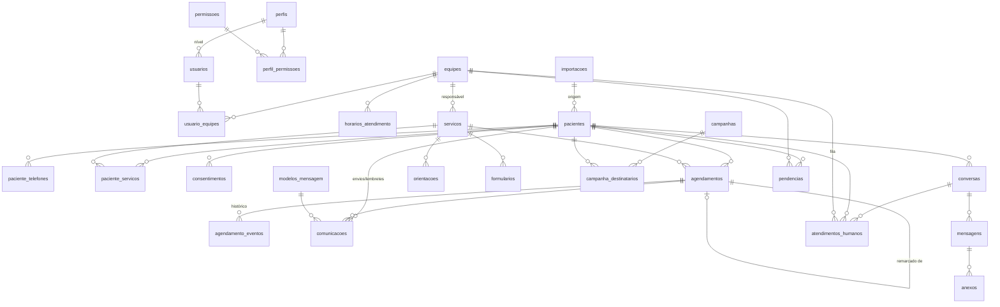
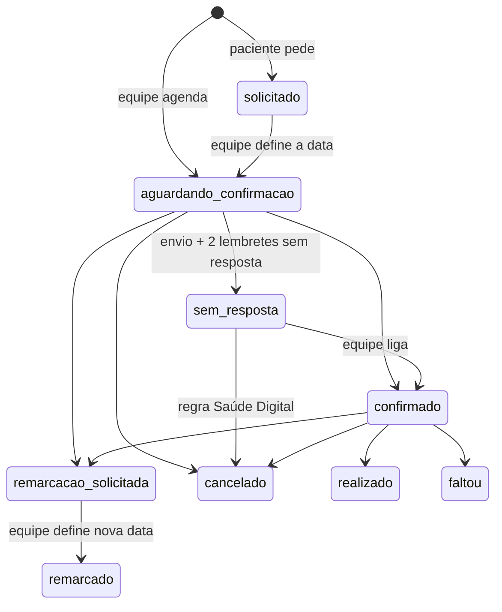
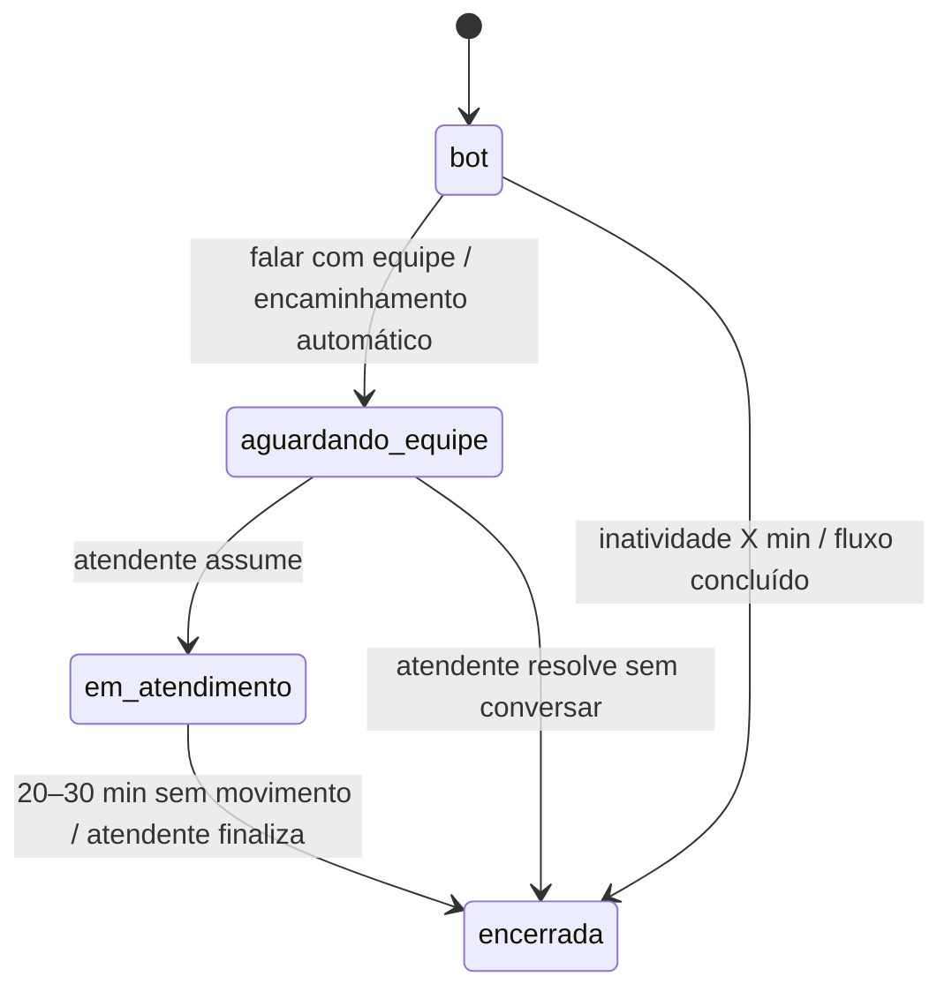

# Estrutura do Banco de Dados (proposta)

Planejamento – nada implementado ainda. Banco sugerido: **PostgreSQL**
(relacional, transações para mudanças de status consistentes, `jsonb` para dados
flexíveis coletados pelo bot). Requisitos em [`REQUISITOS.md`](REQUISITOS.md).

Convenções:
- Chaves primárias `uuid` (evita expor sequência de pacientes em URLs).
- Todas as tabelas têm `criado_em` e `atualizado_em` (`timestamptz`),
  omitidos abaixo.
- Datas/horas sempre em `timestamptz`; exibição em `America/Recife`.
- Exclusão lógica (`ativo`/`excluido_em`) para dados de pacientes – nada é
  apagado fisicamente sem política de retenção definida.

---

## 1. Visão geral (diagrama)

Agrupamento:
| Grupo | Tabelas |
|---|---|
| Acesso | `perfis`, `permissoes`, `perfil_permissoes`, `usuarios`, `equipes`, `usuario_equipes` |
| Cadastro | `servicos`, `pacientes`, `paciente_telefones`, `paciente_servicos`, `consentimentos`, `importacoes` |
| Agenda | `agendamentos`, `agendamento_eventos` |
| Mensagens | `modelos_mensagem`, `comunicacoes`, `campanhas`, `campanha_destinatarios`, `orientacoes`, `formularios` |
| Conversa | `conversas`, `mensagens`, `anexos` |
| Trabalho da equipe | `atendimentos_humanos`, `pendencias`, `notificacoes` |
| Sistema | `whatsapp_conexao`, `horarios_atendimento`, `feriados`, `tarefas_agendadas`, `configuracoes`, `auditoria` |

---

## 2. Acesso

### `usuarios`
| Coluna | Tipo | Observação |
|---|---|---|
| id | uuid PK | |
| nome | text | |
| email | text unique | login |
| senha_hash | text | bcrypt/argon2 |
| perfil_id | FK perfis | nível de acesso |
| dois_fatores_segredo | text null | 2FA (Admin/Supervisão) |
| bloqueado_ate | timestamptz null | bloqueio após tentativas de login |
| ativo | bool | |
| ultimo_acesso_em | timestamptz | |

### `perfis` (níveis de acesso)
| Coluna | Tipo | Observação |
|---|---|---|
| id | uuid PK | |
| codigo | text unique | `admin`, `supervisao`, `atendente`, `equipe_especifica` |
| nome | text | |
| nivel | int | 1 (maior) a 4 – Supervisão só gerencia usuários de nível maior que o seu |
| escopo_equipe | bool | true = só vê dados das suas equipes |
| sistema | bool | perfis padrão não podem ser apagados |

### `permissoes`
Lista fixa de ações verificadas pela API, no formato `recurso.acao`:
`pacientes.ver`, `pacientes.ver_dados_completos`, `pacientes.editar`,
`pacientes.importar`, `pacientes.exportar`, `agendamentos.gerenciar`,
`agendamentos.marcar_realizado`, `campanhas.enviar`, `fila.atender`,
`fila.transferir`, `prontuario.registrar`, `telefones.validar`,
`agenda.ver`, `relatorios.ver`,
`relatorios.completos`, `admin.mensagens`, `admin.orientacoes`,
`admin.formularios`, `admin.servicos`, `admin.prazos`, `admin.horarios`,
`admin.usuarios`, `admin.equipes`, `admin.permissoes`, `auditoria.ver`,
`integracoes.gerenciar`.
Colunas: `codigo` (PK), `descricao`, `grupo` (para a tela de permissões).

### `perfil_permissoes`
`perfil_id` FK, `permissao_codigo` FK – PK composta. Carga inicial conforme
a matriz da seção 3.9 de `REQUISITOS.md`; Admin pode ajustar.

### `equipes`
| Coluna | Tipo | Observação |
|---|---|---|
| id | uuid PK | |
| nome | text | Saúde Digital, Pesquisa FA, Aconselhamento genético |
| descricao | text | |

### `usuario_equipes`
`usuario_id` FK, `equipe_id` FK – PK composta. Um usuário pode estar em
várias equipes (define quais filas ele vê).

---

## 3. Cadastro

### `servicos` (linhas de cuidado)
| Coluna | Tipo | Observação |
|---|---|---|
| id | uuid PK | |
| codigo | text unique | `pre_cateterismo_regulacao`, `pre_cateterismo_mutirao`, `pos_angioplastia`, `fibrilacao_atrial`, `aconselhamento_genetico`, `outros` |
| nome | text | exibido no menu do bot |
| equipe_id | FK equipes | fila padrão dos encaminhamentos |
| exibir_no_menu | bool | aparece na pergunta "qual serviço?" |
| ordem_menu | int | |
| dias_antes_procedimento | int null | regra "teleconsulta 7 dias antes" – só para **sugerir** a data à equipe |
| duracao_padrao_min | int | duração usada ao criar o agendamento |
| link_padrao | text null | link fixo da sala, se houver |
| orientacoes_padrao | text | entra na confirmação |
| modelo_confirmacao_id | FK modelos_mensagem null | null = modelo genérico 3.1 |
| link_minutos_antes | int | quando enviar o link (msg 7), ex.: 10 |
| lembrete_horas_antes | int | lembrete + confirmação de presença |
| formulario_id | FK formularios null | avaliação enviada após a consulta |
| ativo | bool | |

### `pacientes`
| Coluna | Tipo | Observação |
|---|---|---|
| id | uuid PK | |
| nome_completo | text | |
| nome_social | text null | |
| cpf | varchar(11) null unique | só dígitos; **único identificador**; null apenas em `pre_cadastro` |
| cartao_sus | varchar(15) null | apenas informativo (vem da lista da regulação); **não** identifica o paciente |
| data_nascimento | date | validação de identidade |
| prontuario | text null unique | nº do prontuário do hospital – **opcional**, preenchido só se o paciente tiver; nenhum fluxo depende dele |
| origem | enum | `regulacao`, `mutirao`, `base_procape`, `contato_espontaneo`, `importacao` |
| numero_solicitacao | text null | nº da regulação |
| observacoes | text | uso interno da equipe (coluna *Observações* da planilha) |
| importacao_id | FK importacoes null | planilha de origem |
| excluido_em | timestamptz null | exclusão lógica |

| situacao_cadastro | enum | `pre_cadastro`, `completo` |
| anonimizado_em | timestamptz null | retenção LGPD (5 anos após o último contato) |

Regra: cadastro `completo` exige `cpf` (check constraint), com dígitos
validados. `pre_cadastro` (ex.: importado da regulação sem CPF) aceita nome,
data de nascimento e telefone; o bot pede o CPF na primeira interação.

Índices: `cpf`, `prontuario`, `(lower(unaccent(nome_completo)))`
com trigram para busca por nome.

### `paciente_telefones`
| Coluna | Tipo | Observação |
|---|---|---|
| id | uuid PK | |
| paciente_id | FK | |
| numero | varchar(20) | formato E.164 (`+5581...`) |
| whatsapp | bool | |
| principal | bool | um principal por paciente (índice único parcial) |
| status | enum | `ativo`, `pendente_validacao` (número novo informado pelo paciente), `inativo` |
| validado_por | FK usuarios null | quem confirmou com documento |
| validado_em | timestamptz null | |

Índice em `numero` – é por ele que o bot identifica o paciente ao receber
mensagem. Um mesmo número pode pertencer a mais de um paciente (familiar que
cuida de dois pacientes) → o bot pergunta de quem se trata.

### `paciente_servicos`
| Coluna | Tipo | Observação |
|---|---|---|
| id | uuid PK | |
| paciente_id | FK | |
| servico_id | FK | |
| status | enum | `ativo`, `concluido`, `inativo` |
| inicio_em / fim_em | date | |

Permite saber, quando o paciente escreve, em que serviço ele está ativo e
sugerir no menu.

### `importacoes`
Registro de cada planilha importada (menu Pacientes › Importar planilha).
| Coluna | Tipo | Observação |
|---|---|---|
| id | uuid PK | |
| arquivo_nome | text | nome original |
| servico_id | FK | serviço escolhido na importação |
| usuario_id | FK | quem importou |
| total_linhas, criados, atualizados, ignorados | int | resumo |
| erros | jsonb | linha → motivo (data inválida, telefone sem DDD…) |
| mapeamento | jsonb | coluna da planilha → campo do sistema usado |
| criado_em | timestamptz | |

O arquivo em si **não é guardado** depois de processado (minimização).
Pacientes e agendamentos criados guardam `importacao_id` para rastreio.

### `consentimentos`
Registro da **ciência** do aviso de privacidade (não é consentimento – a
base legal é a tutela da saúde).
`id`, `paciente_id` (null se ainda não identificado), `telefone`, `tipo`
(`aviso_privacidade`), `versao_texto`, `ciente_em`.

---

## 4. Agenda

Não há tabela de disponibilidade: **a equipe define dia e hora** ao criar o
agendamento (sem autoagendamento e sem remarcação automática). A agenda é a
visão em calendário dos próprios `agendamentos`.

### `agendamentos`
| Coluna | Tipo | Observação |
|---|---|---|
| id | uuid PK | |
| paciente_id | FK | |
| servico_id | FK | |
| tipo | enum `tipo_agendamento` | `teleconsulta`, `procedimento`, `telemonitoramento`, `consulta_presencial` |
| descricao | text | ex.: "Cateterismo", "Teleconsulta de acompanhamento" |
| data_hora | timestamptz null | null enquanto `solicitado` |
| duracao_min | int | |
| link_teleconsulta | text null | inserido pela equipe na área "Link da teleconsulta"; padrão = `servicos.link_padrao` |
| link_atualizado_por / link_atualizado_em | FK usuarios / timestamptz | última alteração do link (histórico completo na auditoria) |
| orientacoes | text | copiado do serviço, editável |
| status | enum `status_agendamento` | ver abaixo |
| origem | enum | `equipe`, `campanha`, `solicitacao_bot` (paciente pediu pelo bot; equipe definiu a data), `remarcacao` |
| preferencia_paciente | text null | ex.: "Tarde" – informado ao pedir agendamento/remarcação |
| remarcado_de_id | FK agendamentos null | encadeia o histórico de remarcações |
| campanha_id | FK null | |
| confirmado_em, cancelado_em | timestamptz null | |
| motivo_cancelamento | text null | |
| lembretes_enviados | int | controle da regra de não resposta |
| presenca_confirmada_em | timestamptz null | resposta ao lembrete (3.3) |
| link_enviar_em | timestamptz null | calculado de `data_hora - servico.link_minutos_antes`, editável |
| link_enviado_em | timestamptz null | último envio (inclui "Enviar agora" e "Reenviar") |
| link_envio_status | enum | `sem_link`, `programado`, `enviado`, `falhou` |
| realizado_em | timestamptz null | equipe marca → dispara agradecimento/avaliação |
| avaliacao_enviada_em | timestamptz null | |
| ultimo_envio_em | timestamptz | |
| criado_por | FK usuarios null | null = bot |

`status_agendamento`:

| Valor | Cor | Significado |
|---|---|---|
| `solicitado` | 🟣 | pedido do paciente aguardando a equipe definir a data |
| `aguardando_confirmacao` | ⚪ | mensagem enviada |
| `confirmado` | 🟢 | |
| `remarcacao_solicitada` | 🟡 | |
| `remarcado` | – | substituído por outro agendamento (`remarcado_de_id`) |
| `cancelado` | 🔴 | |
| `sem_resposta` | 🔵 | regra de não resposta |
| `realizado` | – | |
| `faltou` | – | |

### `agendamento_eventos` (histórico)
| Coluna | Tipo | Observação |
|---|---|---|
| id | uuid PK | |
| agendamento_id | FK | |
| status_anterior / status_novo | enum | |
| ator | enum | `bot`, `paciente`, `usuario`, `sistema` (jobs) |
| usuario_id | FK null | |
| mensagem_id | FK null | resposta do paciente que gerou o evento |
| observacao | text | |
| criado_em | timestamptz | |

É a base da linha do tempo de agendamentos (confirmação, cancelamento,
remarcação).

---

## 5. Disparo

### `campanhas`
`id`, `nome`, `servico_id`, `modelo_mensagem_id`, `data_referencia`
(ex.: data do cateterismo), `status` (`rascunho`, `enviando`, `enviada`),
`criado_por`, `enviada_em`.

### `campanha_destinatarios`
`id`, `campanha_id`, `paciente_id`, `agendamento_id` (null),
`status_envio` (`pendente`, `enviado`, `entregue`, `lido`, `respondido`,
`falhou`), `erro`, `enviado_em`.

### `modelos_mensagem`
| Coluna | Tipo | Observação |
|---|---|---|
| id | uuid PK | |
| chave | text | `primeiro_contato_pre_cateterismo`, `confirmacao_agendamento`, `lembrete_sem_resposta`, `lembrete_consulta`, `encaminhado_equipe`, … |
| servico_id | FK null | modelo específico por serviço (null = geral) |
| texto | text | com variáveis `{{nome}}`, `{{data}}`, `{{hora}}`, `{{link}}`, `{{orientacoes}}` |
| botoes | jsonb | ex.: `["Confirmar","Remarcar","Cancelar"]` |
| opcoes | jsonb | opções numeradas, ex.: `[{"n":1,"texto":"Confirmo minha presença","acao":"confirmar","palavras":["confirmo","sim"]}]` |
| ativo | bool | |

### `comunicacoes` (registro de cada envio que espera ou não resposta)
Atende ao item 6 das mensagens: data do primeiro contato, dos lembretes, se
houve resposta, status e necessidade de intervenção.
| Coluna | Tipo | Observação |
|---|---|---|
| id | uuid PK | |
| paciente_id | FK | |
| agendamento_id | FK null | |
| pendencia_id | FK null | quando for a mensagem 8.3 |
| modelo_mensagem_id | FK | qual texto foi usado |
| finalidade | enum | `primeiro_contato`, `convite`, `confirmacao_agendamento`, `lembrete_sem_resposta`, `lembrete_consulta`, `link_teleconsulta`, `agradecimento_avaliacao`, `pendencia_paciente`, `faltou`, `remarcacao`, `cancelamento` |
| sequencia | int | 0 = envio original, 1 = 1º lembrete, 2 = 2º lembrete |
| comunicacao_origem_id | FK comunicacoes null | lembrete aponta para o envio original |
| mensagem_id | FK mensagens | mensagem efetivamente enviada |
| agendada_para | timestamptz null | envios programados (link, lembrete) |
| enviada_em | timestamptz null | |
| status_entrega | enum | `programada`, `enviada`, `entregue`, `lida`, `falhou`, `cancelada` |
| espera_resposta | bool | |
| respondida_em | timestamptz null | |
| resposta | text null | ex.: `confirmou`, `remarcar`, `cancelar`, `quero_agendar` |
| requer_equipe | bool | true quando esgotou os lembretes |

Consulta típica: "primeiro contato em 18/10, lembrete 1 em 19/10, lembrete
2 em 20/10, sem resposta, requer equipe" – direto na ficha do paciente.

### `orientacoes`
Respostas que o bot pode dar (seção 4.15 dos requisitos).
| Coluna | Tipo | Observação |
|---|---|---|
| id | uuid PK | |
| servico_id | FK null | null = vale para todos |
| titulo | text | aparece na lista do menu "Orientações" |
| palavras_chave | text[] | "jejum", "exame", "remédio"… |
| texto | text | conteúdo enviado, revisado pela equipe |
| ordem | int | |
| ativo | bool | |
| atualizado_por | FK usuarios | |

### `formularios`
`id`, `servico_id`, `tipo_agendamento` (null = todos), `nome`, `url`,
`ativo`. Escolhido automaticamente na mensagem de agradecimento.

---

## 6. Conversa

### `conversas`
Uma "sessão" de atendimento. Encerrada por trava de tempo ou pela equipe;
nova mensagem depois disso abre nova conversa.

| Coluna | Tipo | Observação |
|---|---|---|
| id | uuid PK | |
| paciente_id | FK null | null até identificar |
| telefone | varchar(20) | número do WhatsApp |
| servico_id | FK null | serviço identificado |
| origem | enum | `paciente` (ele iniciou), `ativo` (PROCAPE iniciou: campanha/agendamento) |
| estado | enum `estado_conversa` | `bot`, `aguardando_equipe`, `em_atendimento`, `encerrada` |
| etapa_fluxo | text | nó atual da máquina de estados do bot (ex.: `identificacao.cpf`, `menu`, `remarcacao.preferencia`) |
| dados_coletados | jsonb | respostas parciais do fluxo (nome, CPF digitado, horário escolhido…) |
| tentativas_nao_entendidas | int | após 2 → encaminha |
| identidade_validada | bool | passou pela validação nesta conversa |
| agendamento_id | FK null | agendamento em foco (quando veio de uma mensagem dele) |
| expira | bool | false para contato ativo |
| atendente_id | FK usuarios null | quem assumiu |
| iniciada_em | timestamptz | |
| ultima_msg_paciente_em | timestamptz | |
| ultima_atividade_em | timestamptz | controla as travas |
| encerrada_em | timestamptz null | |
| motivo_encerramento | enum null | `timeout_bot`, `timeout_equipe`, `finalizada_equipe`, `fluxo_concluido` |
| resumo | text null | resumo do atendimento (equipe ou, no futuro, IA) |

Índice parcial: uma conversa não encerrada por `telefone`.

### `mensagens`
| Coluna | Tipo | Observação |
|---|---|---|
| id | uuid PK | |
| conversa_id | FK | |
| direcao | enum | `entrada`, `saida` |
| autor | enum | `paciente`, `bot`, `usuario` |
| usuario_id | FK null | atendente que enviou |
| tipo | enum | `texto`, `imagem`, `documento`, `audio` |
| conteudo | text | texto exibido |
| payload | jsonb | opção escolhida, variáveis usadas no modelo etc. |
| whatsapp_id | text unique | id da mensagem no WhatsApp (evita processar duas vezes) |
| status_entrega | enum | `enviada`, `entregue`, `lida`, `falhou` |
| destaque | bool | "mensagem principal" para o resumo |
| criada_em | timestamptz | |

### `anexos`
`id`, `mensagem_id`, `paciente_id`, `categoria` (`exame`, `documento_identidade`,
`outro`), `arquivo_chave` (caminho no armazenamento privado), `mime`,
`tamanho_bytes`, `nome_original`.

---

## 7. Trabalho da equipe

### `atendimentos_humanos` (fila)
| Coluna | Tipo | Observação |
|---|---|---|
| id | uuid PK | |
| conversa_id | FK | |
| paciente_id | FK null | |
| equipe_id | FK | fila de destino (pelo serviço) |
| agendamento_id | FK null | ex.: remarcação |
| motivo | enum `motivo_encaminhamento` | `paciente_solicitou`, `remarcacao`, `nao_entendido`, `fora_do_fluxo`, `decisao_equipe`, `problema_agendamento`, `inconsistencia_dados`, `queixa_clinica`, `urgencia` (palavra de alerta), `direitos_titular` (pedido LGPD), `impossibilitado` (não pode realizar a consulta), `sem_resposta`, `orientacao_inexistente` |
| origem | enum | `paciente`, `bot_automatico` |
| queixa | text | o que o paciente relatou |
| prioridade | enum | `urgente`, `alta`, `normal`, `baixa` |
| status | enum | `aberto`, `em_atendimento`, `aguardando_paciente`, `resolvido` |
| atribuido_a | FK usuarios null | |
| aberto_em, assumido_em, resolvido_em | timestamptz | indicadores de tempo de resposta |
| resolucao | text | o que foi feito |

Ordenação da fila: `prioridade`, depois `aberto_em` ascendente.

### `pendencias`
Tarefas que **não são conversa**, mas travam o fluxo do paciente. Podem
depender da **equipe** ou do **paciente** (mensagem 8.3).
| Coluna | Tipo | Observação |
|---|---|---|
| id | uuid PK | |
| paciente_id | FK | |
| tipo | enum | `agendar` (definir data de solicitação ou remarcação), `validar_telefone`, `ligar_sem_resposta`, `conferir_dados`, `paciente_enviar_documento`, `paciente_enviar_informacao`, `outro` |
| responsavel | enum | `equipe`, `paciente` |
| equipe_id | FK | equipe que acompanha (mesmo quando depende do paciente) |
| solicitacao_paciente | text null | texto de `{{pendencia_descricao}}` ("cópia do exame de sangue") |
| agendamento_id / conversa_id | FK null | contexto |
| descricao | text | |
| status | enum | `aberta`, `em_andamento`, `aguardando_paciente`, `recebida` (paciente respondeu – equipe confere), `concluida`, `cancelada` |
| resposta_mensagem_id | FK mensagens null | mensagem/anexo com que o paciente atendeu |
| prazo | timestamptz null | |
| responsavel_id | FK usuarios null | |
| concluida_em / concluida_por | | `agendar` é concluída automaticamente quando a equipe salva o agendamento |

### `notificacoes`
`id`, `usuario_id` (null = toda a equipe), `equipe_id`, `tipo`
(`novo_atendimento`, `nova_pendencia`, `pendencia_recebida`, `mensagem_paciente`, `sem_resposta`, `link_ausente`), `referencia_tipo`,
`referencia_id`, `lida_em`.

---

## 8. Sistema

### `whatsapp_conexao`
Estado da conexão do Baileys (um registro por número).
`id`, `numero`, `status` (`conectado`, `aguardando_qr`, `desconectado`,
`bloqueado`), `credenciais` (bytea **criptografado** – equivale à senha do
número), `conectado_em`, `ultimo_evento_em`, `ultimo_erro`.
Mudanças de status geram notificação para a Supervisão e auditoria.

### `horarios_atendimento`
`id`, `equipe_id`, `dia_semana` (0–6), `inicio` (time), `fim` (time).
Carga inicial: seg–sex, 08:00–17:00. Usado para a mensagem "fora do
horário" e para o texto `{{horario_atendimento}}`.

### `feriados`
`data` (PK), `descricao`, `equipe_id` (null = todas).

### `tarefas_agendadas`
Registro persistente dos jobs com hora marcada (lembretes, travas), para que
nada se perca se o servidor reiniciar.
`id`, `tipo` (`lembrete_sem_resposta`, `marcar_sem_resposta`,
`lembrete_consulta`, `enviar_link`, `enviar_avaliacao`, `encerrar_conversa`), `referencia_tipo`,
`referencia_id`, `executar_em`, `status` (`pendente`, `executada`,
`cancelada`, `falhou`), `tentativas`, `erro`.

### `configuracoes`
Chave/valor (`jsonb`) editável pela coordenação:
| Chave | Valor inicial |
|---|---|
| `bot.timeout_inatividade_min` | 15 |
| `equipe.timeout_inatividade_min` | 30 |
| `nao_resposta.horas_entre_lembretes` | 24 |
| `nao_resposta.quantidade_lembretes` | 2 |
| `nao_resposta.horas_apos_ultimo_lembrete` | 24 (então encaminha para a equipe) |
| `nao_resposta.acao_final` | `sinalizar` (nunca cancela automaticamente) |
| `nao_resposta.horas_destaque_antes_consulta` | 48 |
| `importacao.ddd_padrao` | 81 |
| `importacao.equivalencia_situacao` | `{"confirmado":"confirmado","remarcar":"remarcacao_solicitada","cancelado":"cancelado","nao atende":"sem_resposta","realizado":"realizado","faltou":"faltou"}` |
| `lembrete_consulta.horas_antes` | 24 (padrão; o serviço pode sobrescrever) |
| `link.minutos_antes` | 10 (padrão; o serviço pode sobrescrever) |
| `avaliacao.horas_apos_realizada` | 0 (imediato) |
| `bot.max_tentativas_nao_entendidas` | 2 |
| `bot.palavras_urgencia` | `["dor no peito","aperto no peito","falta de ar","sangramento","desmaio","desmaiei","palpitação","infarto"]` |
| `seguranca.sessao_inatividade_min` | 30 |
| `seguranca.tentativas_login` | 5 (bloqueio de 15 min) |
| `lgpd.retencao_anos_apos_ultimo_contato` | 5 |
| `lgpd.dias_manter_anexos_apos_consulta` | 90 |
| `auditoria.retencao_anos` | 5 |

### `auditoria`
`id`, `usuario_id`, `acao` (`visualizou_paciente`, `alterou`, `exportou`,
`login`…), `entidade`, `entidade_id`, `antes` jsonb, `depois` jsonb, `ip`,
`criado_em`. Exigência LGPD para dados de saúde.

---

## 9. Visões (consultas prontas)

- **`vw_lista_pacientes`** – um registro por paciente com: dados básicos,
  serviço ativo, status/cor do agendamento mais recente, se há atendimento
  ou pendência aberta, data do último contato. Alimenta a lista principal
  (ordenação "não atendidos primeiro, mais antigos primeiro").
- **`vw_linha_do_tempo_paciente`** – `UNION` de `agendamento_eventos`,
  `atendimentos_humanos`, `pendencias`, `comunicacoes`, mensagens com `destaque`, início e
  fim de conversas → a ficha "o que já aconteceu" da seção 3.2.
- **`vw_comunicacoes_pendentes`** – pacientes com envio sem resposta, em
  que etapa estão (original, lembrete 1, lembrete 2) e se requerem equipe.
- **`vw_agenda`** – agendamentos `confirmado`/`aguardando_confirmacao` por
  dia, para o calendário.

---

## 10. Pontos em aberto que afetam o banco
1. ~~Dados cadastrais~~ – definido: colunas da planilha + CPF.
   Pendente com a equipe: valores da coluna *Situação* e o significado do
   telemonitoramento (`REQUISITOS.md` 3.5).
2. ~~CPF ou Cartão SUS~~ – definido: somente CPF.
3. Integração com o sistema do hospital – se houver no futuro, `prontuario`
   pode ser preenchido automaticamente.
4. ~~Política de retenção~~ – definida: 5 anos após o último contato →
   anonimização; anexos apagados 90 dias após a consulta (job diário).
