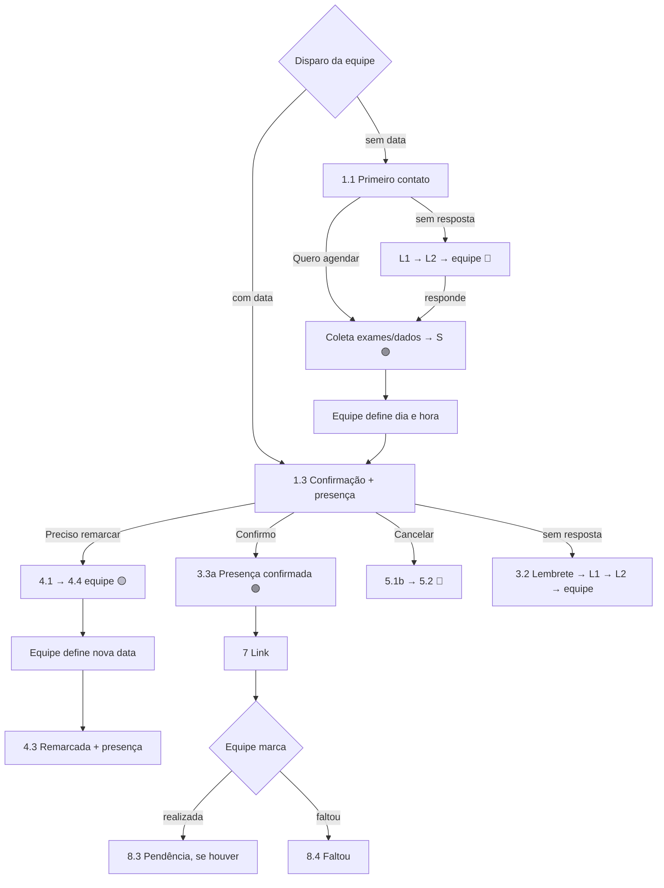
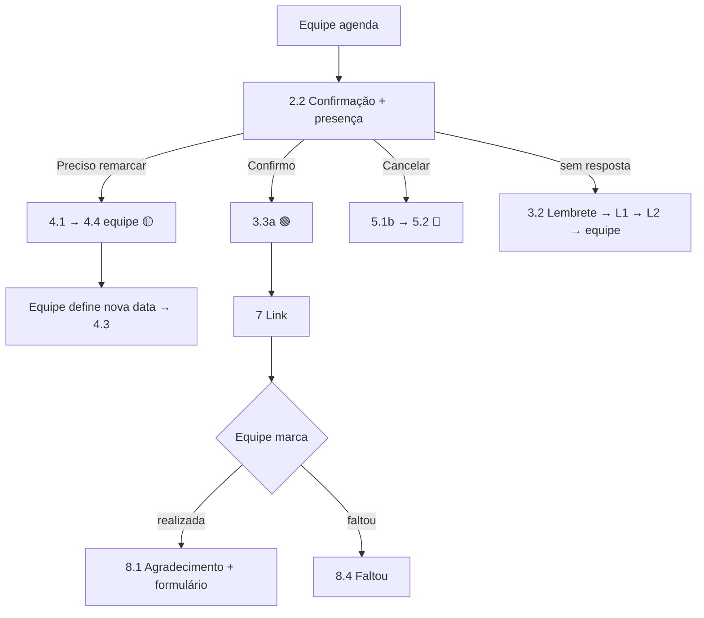

# Catálogo de Mensagens do Bot – Saúde Digital

Planejamento – nada implementado ainda. Textos da equipe da Saúde Digital
**com os ajustes sugeridos já aplicados** e padronizados de acordo com as
regras do sistema (seção 1). Os textos originais estão no Anexo para
comparação. Tudo continua **sujeito à validação da equipe** antes do envio
para aprovação da Meta.

Cada mensagem é um registro em `modelos_mensagem`
([`BANCO_DE_DADOS.md`](BANCO_DE_DADOS.md)), identificado pela **chave** e
editável na área administrativa.

---

## 1. Padrões adotados em todas as mensagens

| # | Padrão | Motivo |
|---|---|---|
| P1 | **Saudação com o primeiro nome** (`{{nome}}`) | Regra do sistema: o bot não expõe dados pessoais além do primeiro nome; mais próximo e curto |
| P2 | Apresentação única: **"🫀 Aqui é da equipe de Saúde Digital do PROCAPE."** | Antes variava entre "do PROCAPE" e "da equipe de Saúde Digital" |
| P3 | Assinatura única: **"Equipe de Saúde Digital – PROCAPE"** (rodapé do template) | Padronização; rodapé da Meta aceita até 60 caracteres |
| P4 | **Data sempre com dia da semana e horário**: `{{data}} ({{dia_semana}}), às {{horario}}` | Evita "na próxima semana" fixo e atende ao requisito de informar horário |
| P5 | **Link sempre pelo WhatsApp**, em mensagem própria (msg 7) | Antes a 1.1 falava em e-mail/SMS |
| P6 | **Respostas por botões ou lista**, nunca texto livre quando houver opções | O bot entende com segurança; menos encaminhamentos por "não entendido" |
| P7 | **Confirmação de presença com 3 botões**: Confirmo minha presença · Preciso remarcar · Cancelar | Limite do WhatsApp é 3 botões; cobre o cancelamento previsto |
| P8 | **"👩‍⚕️ Falar com a equipe"** disponível em toda mensagem de sessão que tenha lista | Requisito "sempre disponibilizar" |
| P9 | O bot **não agenda nem remarca**: só a equipe define dia e hora; o bot nunca diz "agendado" antes disso | Regra dos serviços (sem autoagendamento / sem remarcação automática) |
| P10 | Variáveis nunca levam quebra de linha dentro de templates da Meta | Restrição da Meta; listas (orientações, consultas) só em mensagens de sessão |
| P11 | Prontuário nunca é exigido; o bot só pergunta de forma opcional | Prontuário é apenas um número, preenchido se o paciente tiver |

Legenda da coluna "Tipo":
- **Template** – mensagem iniciada pelo PROCAPE ou fora da janela de 24h;
  precisa de **aprovação prévia da Meta** (categoria *Utilidade*).
- **Sessão** – resposta dentro de conversa ativa (paciente escreveu nas
  últimas 24h); não precisa de aprovação.

Variáveis: `{{nome}}`, `{{tipo_teleconsulta}}`, `{{data}}`,
`{{dia_semana}}`, `{{horario}}`, `{{link}}`, `{{link_formulario}}`,
`{{pendencia_descricao}}`, `{{horario_atendimento}}`,
`{{minutos_link}}`.

---

## 2. Resumo do catálogo

| # | Chave | Serviço | Gatilho | Tipo | Botões / respostas |
|---|---|---|---|---|---|
| 1.1 | `pre_cat.primeiro_contato` | Pré-cateterismo | Equipe dispara **sem data** (individual ou lote) | Template | Quero agendar · Falar com a equipe |
| 2.1 | `pos_angio.convite` | Pós-angioplastia | Equipe dispara **sem data** (opcional) | Template | Quero agendar · Falar com a equipe |
| S | `geral.solicitacao_recebida` | Todos | Bot registrou a solicitação de agendamento | Sessão | – |
| 1.3 | `pre_cat.agendamento_confirmado` | Pré-cateterismo | Equipe salva o agendamento (ou disparo com data) | Template | Confirmo minha presença · Preciso remarcar · Cancelar |
| 2.2 | `pos_angio.agendamento_confirmado` | Pós-angioplastia | Equipe salva o agendamento | Template | Confirmo minha presença · Preciso remarcar · Cancelar |
| 3.1 | `geral.confirmacao_teleconsulta` | Demais serviços | Equipe salva o agendamento | Template | Confirmo minha presença · Preciso remarcar · Cancelar |
| L1 | `geral.lembrete_sem_resposta_1` | Todos | +24h sem resposta | Template | Mesmos da mensagem original |
| L2 | `geral.lembrete_sem_resposta_2` | Todos | +24h após L1 | Template | Mesmos da mensagem original |
| 3.2 | `geral.lembrete_consulta` | Todos | X horas antes | Template | Confirmo minha presença · Preciso remarcar · Cancelar (se ainda não confirmou) |
| 3.3a | `geral.presenca_confirmada` | Todos | Paciente confirma | Sessão | – |
| 1.7 | `geral.impossibilitado` | Todos | Paciente informa que não pode | Sessão | – (encaminha) |
| 4.1 | `remarcacao.preferencia` | Todos | Paciente pede remarcação | Sessão | Manhã · Tarde · Tanto faz |
| 4.4 | `remarcacao.encaminhada` | Todos | Após 4.1 | Sessão | – (encaminha para a equipe) |
| 4.3 | `remarcacao.confirmada` | Todos | Equipe define a nova data | Template | Confirmo minha presença · Preciso remarcar · Cancelar |
| 5.1 | `cancelamento.qual_consulta` | Todos | Cancelar pelo menu com 2+ consultas | Sessão (lista) | Consultas futuras |
| 5.1b | `cancelamento.confirmar` | Todos | Antes de cancelar | Sessão | Sim, cancelar · Não, manter |
| 5.2 | `cancelamento.realizado` | Todos | Cancelamento registrado | Sessão | Quero uma nova data · Não, obrigado(a) |
| 7 | `geral.link_teleconsulta` | Todos | `{{minutos_link}}` min antes | Template | – |
| 8.1 | `pos_angio.agradecimento_avaliacao` | Pós-angioplastia | Equipe marca "realizada" | Template | – |
| 8.2 | `geral.agradecimento_avaliacao` | Demais serviços | Equipe marca "realizada" | Template | – |
| 8.3 | `geral.pendencia_paciente` | Todos | Equipe registra pendência do paciente | Template | – |
| 8.3b | `geral.pendencia_recebida` | Todos | Paciente envia o que foi pedido | Sessão | – |
| 8.4 | `geral.faltou` | Todos | Equipe marca "faltou" | Template | Quero remarcar · Falar com a equipe |
| O | `geral.orientacoes` | Por serviço | Menu "Orientações" ou palavra-chave | Sessão (lista) | Títulos cadastrados · Voltar ao menu · Falar com a equipe |
| 10 | `geral.fora_do_horario` | Todos | Encaminhamento fora do expediente | Sessão | – |
| 11 | `geral.encaminhado_equipe` | Todos | Falar com a equipe / encaminhamento | Sessão | – |
| 12 | `geral.nao_entendido` | Todos | Resposta não reconhecida | Sessão (lista) | Menu de 6 opções |
| M | `geral.menu` | Todos | Paciente inicia conversa | Sessão (lista) | Menu de 6 opções |
| A | `geral.aviso_privacidade` | Todos | Primeiro contato do número | Sessão | Concordo · Falar com a equipe |


---

## 3. Textos propostos

### 1.1 `pre_cat.primeiro_contato` – Template
```
Olá, {{nome}}!
🫀 Aqui é da equipe de Saúde Digital do PROCAPE.

Você foi regulado(a) para realizar um *cateterismo* e, antes do exame, é necessário fazer uma *teleconsulta pré-cateterismo*, que faz parte da preparação para o procedimento.

🧑‍💻 A consulta é *online*: não é necessário ir ao PROCAPE. O link de acesso será enviado *por aqui, no WhatsApp*, no dia e horário agendados.

🧪 Importante: é necessário ter *exames de sangue realizados nos últimos 3 meses*.

✅ Essa etapa é importante para garantir a segurança e a organização do seu procedimento.

📅 Toque em *Quero agendar* para darmos continuidade. Nossa equipe enviará a data e o horário da sua teleconsulta por aqui.
```
Rodapé: `Equipe de Saúde Digital – PROCAPE`
Botões: **Quero agendar** · **Falar com a equipe**
- *Quero agendar* → bot pede os exames (opcional) e dados cadastrais que
  faltarem → mensagem **S**.
- Usada só quando a equipe dispara **sem data**. Se o disparo já tiver data
  e hora, o paciente recebe direto a 1.3.

Ajustes aplicados: A (link pelo WhatsApp), B (botão em vez de "informe sua
disponibilidade" em texto livre), P1, P2.

### 2.1 `pos_angio.convite` – Template
```
Olá, {{nome}}!
🫀 Aqui é da equipe de Saúde Digital do PROCAPE.

Chegou o momento de agendar sua *teleconsulta de retorno pós-angioplastia* com a enfermeira, que faz parte do seu acompanhamento.

🧑‍💻 A consulta é *online*: não é necessário ir ao PROCAPE. O link de acesso será enviado *por aqui, no WhatsApp*, no dia e horário agendados.

📅 Toque em *Quero agendar* e nossa equipe enviará a data e o horário por aqui.
```
Rodapé + botões: iguais à 1.1. Opcional – normalmente a equipe já agenda e
envia direto a 2.2.

### S `geral.solicitacao_recebida` – Sessão
```
Recebemos sua solicitação, {{nome}}! ✅
🫀 Nossa equipe vai definir a data e o horário da sua teleconsulta de {{tipo_teleconsulta}} e enviará por aqui, neste WhatsApp.
```
Antes dela, se for paciente novo, o bot coleta os dados que faltarem e
pergunta o prontuário de forma **opcional** ("Se souber o número do seu
prontuário no PROCAPE, informe; se não, toque em *Não sei / não tenho*").
Registra a solicitação (🟣 `solicitado`) e a pendência "agendar" para a
equipe.

### 1.3 `pre_cat.agendamento_confirmado`
```
Olá, {{nome}}!
🫀 Aqui é da equipe de Saúde Digital do PROCAPE. Sua *teleconsulta pré-cateterismo* está agendada para:

📅 {{data}} ({{dia_semana}})
⏰ {{horario}}

🧑‍💻 A consulta é *online*: não é necessário ir ao PROCAPE. Enviaremos o link *por aqui, no WhatsApp*, {{minutos_link}} minutos antes do horário.

🧪 Lembre-se: tenha em mãos seus *exames de sangue dos últimos 3 meses*.

Por favor, confirme sua participação tocando em uma das opções abaixo.
```
Botões: **Confirmo minha presença** · **Preciso remarcar** · **Cancelar**
Ajustes aplicados: C (data com dia da semana e horário, sem "próxima
semana"), E ("enviaremos"), A.

### 2.2 `pos_angio.agendamento_confirmado`
```
Olá, {{nome}}!
🫀 Aqui é da equipe de Saúde Digital do PROCAPE. Sua *teleconsulta de retorno pós-angioplastia* está agendada para:

📅 {{data}} ({{dia_semana}})
⏰ {{horario}}

🧑‍💻 A consulta é *online*: não é necessário ir ao PROCAPE. Enviaremos o link *por aqui, no WhatsApp*, {{minutos_link}} minutos antes do horário.

📋 Para participar: esteja em um local tranquilo, com boa conexão de internet, e tenha em mãos seus medicamentos em uso e exames recentes.

Por favor, confirme sua participação tocando em uma das opções abaixo.
```
Botões: **Confirmo minha presença** · **Preciso remarcar** · **Cancelar**
As "orientações para participação" (item 2.2) ficam fixas no texto; se a
equipe quiser outras, edita o modelo.

### 3.1 `geral.confirmacao_teleconsulta` – genérica (demais serviços)
```
Olá, {{nome}}! ✅
🫀 Aqui é da equipe de Saúde Digital do PROCAPE.

Sua *teleconsulta de {{tipo_teleconsulta}}* está agendada para:

📅 {{data}} ({{dia_semana}})
⏰ {{horario}}

🧑‍💻 A consulta será *online*. Enviaremos o link *por aqui, no WhatsApp*, {{minutos_link}} minutos antes do horário.

Pedimos que fique atento(a) ao WhatsApp e esteja disponível no horário agendado. Confirme sua participação tocando em uma das opções abaixo.
```
Botões: **Confirmo minha presença** · **Preciso remarcar** · **Cancelar**

Usada por qualquer serviço que não tenha modelo próprio
(`servicos.modelo_confirmacao_id` vazio).

### L1 `geral.lembrete_sem_resposta_1` – Template
```
Olá, {{nome}}!
🫀 Aqui é da equipe de Saúde Digital do PROCAPE.

Ainda não recebemos sua resposta sobre a sua *teleconsulta de {{tipo_teleconsulta}}*. Ela é importante para darmos continuidade ao seu atendimento.

Por favor, toque em uma das opções abaixo.
```
Botões: os da mensagem original (Quero agendar · Falar com a equipe; ou
Confirmo minha presença · Preciso remarcar · Cancelar).

### L2 `geral.lembrete_sem_resposta_2` – Template
```
Olá, {{nome}}!
🫀 Este é nosso último aviso sobre a sua *teleconsulta de {{tipo_teleconsulta}}*.

Se não recebermos sua resposta, nossa equipe entrará em contato por telefone.

Por favor, toque em uma das opções abaixo.
```
Sem resposta em +24h → status 🔵 `sem_resposta`, pendência "ligar para o
paciente" e notificação à equipe.

### 3.2 `geral.lembrete_consulta` – Template (com confirmação de presença)
```
Olá, {{nome}}!
🫀 Lembramos que sua *teleconsulta de {{tipo_teleconsulta}}* será:

📅 {{data}} ({{dia_semana}})
⏰ {{horario}}

🧑‍💻 A consulta é online e o link será enviado por aqui {{minutos_link}} minutos antes.

Para confirmar sua participação, toque em uma das opções:
```
Botões: **Confirmo minha presença** · **Preciso remarcar** · **Cancelar**
(ajuste D) – só para quem ainda não confirmou; quem já confirmou recebe a
versão sem botões. Sem resposta → L1/L2 → equipe (item 2.5).

### 3.3a `geral.presenca_confirmada` – Sessão
```
Presença confirmada! ✅
🫀 Até {{dia_semana}}, {{data}}, às {{horario}}. O link chegará por aqui {{minutos_link}} minutos antes.
```

### 1.7 `geral.impossibilitado` – Sessão
Acionada quando o paciente escreve que não poderá realizar a consulta
(palavras-chave como "não posso", "não vou poder", "estou internado").
```
Entendemos, {{nome}}. 🫀
Registramos que você não poderá realizar a consulta. Nossa equipe vai avaliar a melhor solução e entrará em contato por este WhatsApp.
```
Encaminha com motivo `impossibilitado`.

### 4.1 `remarcacao.preferencia` – Sessão
```
Certo, {{nome}}! 🔄
Para ajudar nossa equipe a encontrar uma nova data, qual período é melhor para você?
```
Botões: **Manhã** · **Tarde** · **Tanto faz**. A resposta vai como
observação no atendimento. Se o paciente escrever algo em vez de tocar no
botão, o texto também é registrado.

### 4.4 `remarcacao.encaminhada` – Sessão
```
Sua solicitação de remarcação foi encaminhada para nossa equipe. 🫀
Enviaremos a nova data e horário por este WhatsApp.
```
Status 🟡 `remarcacao_solicitada` + atendimento na fila (motivo
`remarcacao`). **Vale para todos os serviços** – o bot não remarca sozinho.

### 4.3 `remarcacao.confirmada` – Template
Enviada quando a equipe salva a nova data na plataforma.
```
Olá, {{nome}}!
🫀 Sua teleconsulta de {{tipo_teleconsulta}} foi *remarcada* para:

📅 {{data}} ({{dia_semana}})
⏰ {{horario}}

🧑‍💻 A consulta é online e o link será enviado por aqui {{minutos_link}} minutos antes.
Por favor, confirme sua participação tocando em uma das opções abaixo.
```
Botões: **Confirmo minha presença** · **Preciso remarcar** · **Cancelar**.
O agendamento anterior fica como `remarcado` no histórico.

### 5.1 `cancelamento.qual_consulta` – Sessão (lista)
```
Qual consulta você deseja cancelar?
```
Itens: consultas futuras (`Teleconsulta pré-cateterismo – 19/11 14h00`) +
Falar com a equipe. Pulada quando o pedido veio do botão de uma consulta
específica.

### 5.1b `cancelamento.confirmar` – Sessão
```
Confirma o cancelamento da sua *teleconsulta de {{tipo_teleconsulta}}* de {{data}} ({{dia_semana}}), às {{horario}}?
```
Botões: **Sim, cancelar** · **Não, manter**

### 5.2 `cancelamento.realizado` – Sessão (inclui 5.3)
```
Sua consulta de {{data}} foi cancelada. ❌
🫀 Deseja solicitar uma nova data?
```
Botões: **Quero uma nova data** (→ registra solicitação para a equipe e
envia **S**) · **Não, obrigado(a)** (→ encerra; status 🔴).

### 7 `geral.link_teleconsulta` – Template
```
Olá, {{nome}}!
🫀 Chegou o momento da sua teleconsulta de {{tipo_teleconsulta}}.

Para acessar, utilize o link abaixo:
👉 {{link}}

Pedimos que aguarde na sala virtual até o início do atendimento.
```
Enviada `{{minutos_link}}` minutos antes (padrão 10, configurável por
serviço). Sem link cadastrado na hora → alerta para a equipe e a mensagem não
sai.

### 8.1 `pos_angio.agradecimento_avaliacao` – Template
```
Olá, {{nome}}!
🫀 Agradecemos pela sua participação na consulta de retorno pós-angioplastia com a enfermeira, realizada hoje de forma online.

👩‍⚕️ Esperamos que as orientações tenham sido claras e que a consulta tenha contribuído para o seu acompanhamento e bem-estar.

Para prosseguirmos com seu atendimento, pedimos que responda ao formulário de avaliação:
👉 {{link_formulario}}

Sua participação é muito importante para acompanharmos e aprimorarmos nosso atendimento. Seguimos com você nesse cuidado!
```
Texto original mantido, com P1–P3.

### 8.2 `geral.agradecimento_avaliacao` – Template (demais serviços)
```
Olá, {{nome}}!
🫀 Agradecemos pela sua participação na teleconsulta de {{tipo_teleconsulta}}, realizada hoje.

Sua opinião é muito importante para melhorarmos nosso atendimento. Pedimos que responda ao formulário de avaliação:
👉 {{link_formulario}}

Seguimos à disposição!
```
O formulário vem de `formularios` (serviço + tipo de consulta). Envio
**imediato** quando a equipe marca a consulta como realizada (ajustável em
Prazos).

### 8.3 `geral.pendencia_paciente` – Template
```
Olá, {{nome}}!
🫀 Conforme orientado durante sua teleconsulta, precisamos que você envie: *{{pendencia_descricao}}*.

Você pode enviar por aqui mesmo, neste WhatsApp (foto ou PDF).

Assim que recebermos, daremos continuidade ao seu atendimento.
```
Sem resposta → L1/L2 → equipe.

### 8.3b `geral.pendencia_recebida` – Sessão
```
Recebemos, obrigado(a)! ✅
🫀 Nossa equipe vai conferir e dará continuidade ao seu atendimento.
```
A pendência passa para `recebida` e a equipe é notificada para conferir.

### 8.4 `geral.faltou` – Template (novo)
```
Olá, {{nome}}!
🫀 Sentimos sua falta na teleconsulta de {{tipo_teleconsulta}} de hoje.

Para não atrasar seu atendimento, toque em uma das opções abaixo.
```
Botões: **Quero remarcar** (→ 4.1 → equipe) · **Falar com a equipe**.
Sem resposta → L1/L2 → equipe. Sugestão para o caso "paciente faltou", que
estava em aberto.

### O `geral.orientacoes` – Sessão (lista)
```
📋 Estas são as orientações disponíveis. Toque em *Ver opções* e escolha o assunto.
```
Itens: títulos de `orientacoes` do serviço do paciente + Voltar ao menu +
Falar com a equipe. Ao escolher, o bot envia o texto cadastrado e pergunta
"Posso ajudar em algo mais?" (Menu · Falar com a equipe).
Conteúdo inicial sugerido para a equipe escrever: *Como funciona a
teleconsulta*, *Exames necessários*, *Preparo para o cateterismo*,
*Cuidados após a angioplastia*.

### 10 `geral.fora_do_horario` – Sessão
```
🫀 Recebemos sua mensagem, mas no momento nossa equipe está fora do horário de atendimento.

Nosso atendimento funciona {{horario_atendimento}}.
Sua mensagem ficará registrada e será respondida assim que retornarmos.
```
`{{horario_atendimento}}` = "de segunda a sexta-feira, das 8h às 17h"
(gerado a partir de `horarios_atendimento`). Enviada logo após a 11 quando
o encaminhamento acontece fora do expediente ou em feriado.

### 11 `geral.encaminhado_equipe` – Sessão
```
Certo! 🫀
Vamos encaminhar seu atendimento para nossa equipe.
Pedimos que aguarde nosso retorno por este WhatsApp.
```
Texto original mantido. Antes dela, quando o paciente escolhe "Falar com a
equipe" pelo menu, o bot pergunta: "Conte para nós, em poucas palavras, o
motivo do contato." (vai para o campo **queixa**).

### 12 `geral.nao_entendido` – Sessão (lista)
```
Não conseguimos identificar sua solicitação. 🫀
Para que possamos ajudar, toque em *Ver opções* e escolha uma das opções abaixo:
```
Itens: 📅 Agendamento · 🔄 Remarcação · ❌ Cancelamento · ✅ Confirmação de
consulta · 📋 Orientações · 👩‍⚕️ Falar com a equipe.
Segunda falha seguida → mensagem 11 e encaminhamento (`nao_entendido`).

### M `geral.menu` – Sessão (lista)
```
Olá, {{nome}}! 🫀 Aqui é da equipe de Saúde Digital do PROCAPE.
Como podemos ajudar? Toque em *Ver opções*.
```
Mesmos 6 itens da mensagem 12. Paciente ainda não identificado: "Olá!" sem
nome.

### A `geral.aviso_privacidade` – Sessão
```
🔒 Para seu atendimento, o PROCAPE vai registrar as informações desta conversa, com sigilo e de acordo com a Lei Geral de Proteção de Dados (LGPD).
Seus dados serão usados somente para o seu acompanhamento.
```
Botões: **Concordo** · **Falar com a equipe**. Enviada uma vez por número
(registro em `consentimentos`). **[PENDENTE]** validação do texto pelo
jurídico/DPO do hospital.

---

## 4. Ajustes aplicados

| | Ajuste | Onde | Situação |
|---|---|---|---|
| A | Link sempre pelo WhatsApp | 1.1, 2.1, 1.3, 2.2, 3.1, 3.2, 7 | Aplicado – validar |
| B | "Informe sua disponibilidade" (texto livre) → botão **Quero agendar**; a equipe define a data | 1.1, 2.1 | Aplicado – validar |
| C | Data com dia da semana e **horário**, sem "próxima semana" | 1.3, 2.2, 3.1, 3.2 | Aplicado – validar |
| D | Confirmação de presença com 3 botões (inclui Cancelar) | 3.2 | Aplicado – validar |
| E | "o enviaremos" → "enviaremos" | 1.3, 2.2 | Aplicado |
| F | Menu com 6 opções em mensagem de lista | M, 12 | Aplicado |
| G | Textos que faltavam escritos | L1, L2, 1.7, 2.1, S, 4.x, 5.x, 8.2, 8.3b, A | Sugestão – validar |
| J | Confirmação (1.3, 2.2, 3.1) já pede presença com 3 botões, pois a data vem da equipe | 1.3, 2.2, 3.1, 4.3 | Aplicado – validar |
| H | Nova mensagem para paciente que faltou | 8.4 | Sugestão – validar |
| I | Padrões P1–P10 (primeiro nome, apresentação e assinatura únicas) | Todas | Aplicado – validar |

## 5. Decisões sugeridas para os pontos em aberto

| Ponto | Sugestão adotada no plano | Onde configurar |
|---|---|---|
| Envio do link | 10 min antes, pelo WhatsApp | Admin › Prazos / Serviços |
| Lembrete da consulta | 24h antes, com confirmação de presença | Admin › Prazos / Serviços |
| Não resposta | 2 lembretes a cada 24h, depois equipe | Admin › Prazos |
| Avaliação | Imediata ao marcar "realizada" | Admin › Prazos |
| Paciente faltou | Mensagem 8.4 + regra de não resposta | Admin › Mensagens |
| Agendamento | **Sempre a equipe** define dia e hora (sem autoagendamento) | – |
| Remarcação | **Sempre a equipe** (sem remarcação automática); bot só registra a preferência de período | – |
| Prontuário | Número opcional; o bot pergunta sem exigir | – |
| Plataforma de vídeo / link | Link cadastrado no agendamento (ou padrão da agenda); funciona com link fixo ou por consulta | Agendamento / Agenda |

## 6. Para enviar à Meta (ordem de prioridade)

Templates necessários para o MVP: 1.1, 2.1, 1.3, 2.2, 3.1, 4.3, L1, L2,
3.2, 7, 8.1, 8.2, 8.3, 8.4. Mensagens de sessão não precisam de
aprovação. Nos templates, as variáveis são cadastradas na Meta como
parâmetros; o sistema faz o mapeamento a partir da chave.

---

## 7. Sequências por serviço

### Pré-cateterismo


### Pós-angioplastia


---

## Anexo – textos originais da equipe

<details>
<summary>1.1 Primeiro contato (original)</summary>

```
Prezado(a) [NOME DO PACIENTE],
🫀 Aqui é do PROCAPE.
Você foi regulado(a) para realizar um cateterismo e, antes do exame, será necessário realizar uma teleconsulta de triagem.
Estamos entrando em contato para agendar sua teleconsulta pré-cateterismo, que faz parte da preparação para o exame.
📅 Precisamos combinar com você a melhor data e horário para realização dessa teleconsulta.
🧑‍💻 A consulta será online, ou seja, não é necessário ir ao PROCAPE. O link de acesso será enviado para o seu e-mail e/ou SMS no dia agendado.
🧪 Importante: é necessário ter exames de sangue atualizados, realizados nos últimos 3 meses.
✅ Essa etapa é importante para garantir a segurança e organização do seu procedimento.
Por favor, nos informe sua disponibilidade para realizarmos o agendamento.
Qualquer dúvida, estamos à disposição!
Atenciosamente,
Equipe PROCAPE
```
</details>

<details>
<summary>1.3 / 2.2 Confirmação (original)</summary>

```
Prezado(a) XXXXXXXX, olá!
🫀 Aqui é do PROCAPE. Estamos passando para confirmar que sua *teleconsulta de pré-cateterismo* (ou *de retorno pós-angioplastia*) será na próxima semana, dia xx/xx/2026.
🧑‍💻 A consulta é *online* e o enviaremos o link *por aqui, no WhatsApp*.
✅ Qualquer dúvida, estamos à disposição!
```
</details>

<details>
<summary>3.1 Confirmação genérica, 7 Link, 8 Agradecimento, 9.3 Pendência, 10, 11, 12 (originais)</summary>

Mantidos na íntegra na seção 3, com as mudanças apenas de saudação
(primeiro nome), apresentação/assinatura padronizadas e, na 12, a lista
interativa no lugar da lista numerada.
</details>
