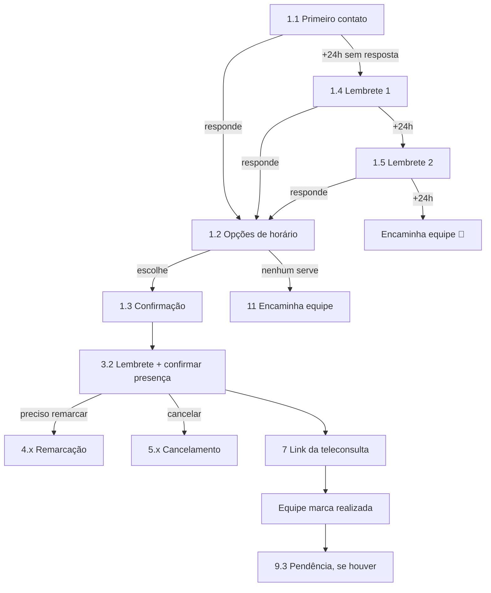
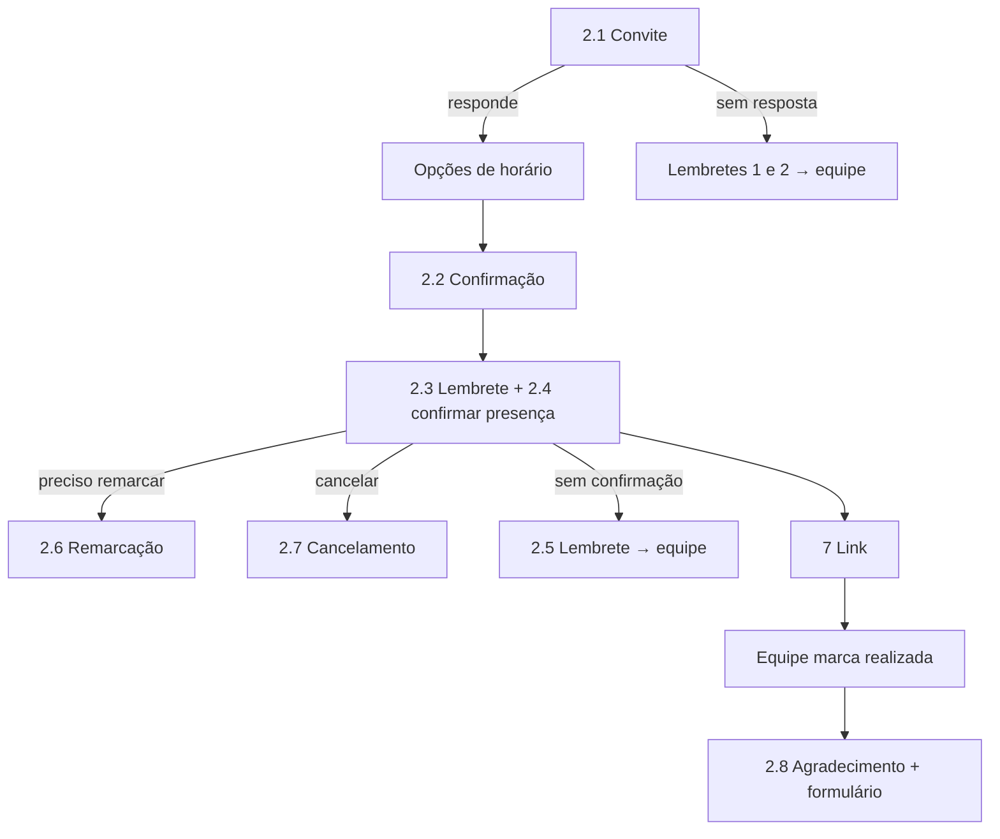

# Catálogo de Mensagens do Bot – Saúde Digital

Planejamento – nada implementado ainda. Textos enviados pela equipe da Saúde
Digital, organizados como **modelos de mensagem** (`modelos_mensagem` em
[`BANCO_DE_DADOS.md`](BANCO_DE_DADOS.md)). Os textos ficam **editáveis na
área administrativa**; o código só conhece a **chave** do modelo.

Legenda da coluna "Tipo":
- **Template Meta** – mensagem iniciada pelo PROCAPE ou fora da janela de 24h;
  precisa de **aprovação prévia da Meta** (categoria *Utilidade*). Variáveis
  entram como `{{1}}`, `{{2}}`… no cadastro da Meta.
- **Sessão** – resposta dentro de uma conversa ativa (paciente escreveu nas
  últimas 24h); texto livre, sem aprovação.

Variáveis disponíveis: `{{nome}}` (primeiro nome), `{{nome_completo}}`,
`{{tipo_teleconsulta}}`, `{{data}}` (dd/mm/aaaa), `{{dia_semana}}`,
`{{horario}}`, `{{link}}`, `{{link_formulario}}`, `{{pendencia_descricao}}`,
`{{horario_atendimento}}`, `{{opcoes_horario}}`.

---

## 1. Resumo do catálogo

| # | Chave | Serviço | Gatilho | Tipo | Respostas/botões |
|---|---|---|---|---|---|
| 1.1 | `pre_cat.primeiro_contato` | Pré-cateterismo | Equipe dispara (individual ou lote) | Template Meta | **Ver horários** · Falar com a equipe |
| 1.2 | `geral.opcoes_horario` | Todos | Paciente pede horários | Sessão (lista) | Até 10 horários + "Nenhum serve" |
| 1.3 | `pre_cat.agendamento_confirmado` | Pré-cateterismo | Horário reservado | Sessão / Template | – |
| 1.4 | `geral.lembrete_sem_resposta_1` | Todos | +24h sem resposta (configurável) | Template Meta | mesmos botões da mensagem original |
| 1.5 | `geral.lembrete_sem_resposta_2` | Todos | +24h após o 1º lembrete | Template Meta | idem |
| 1.7 | `geral.impossibilitado` | Todos | Paciente diz que não pode fazer a consulta | Sessão | – (encaminha) |
| 1.8 | `orientacoes.*` | Por serviço | Paciente pergunta / escolhe "Orientações" | Sessão | Voltar ao menu · Falar com a equipe |
| 2.1 | `pos_angio.convite` | Pós-angioplastia | Equipe dispara | Template Meta | **Ver horários** · Falar com a equipe |
| 2.2 | `pos_angio.agendamento_confirmado` | Pós-angioplastia | Horário reservado / equipe agenda | Template Meta | – |
| 2.8 | `pos_angio.agradecimento_avaliacao` | Pós-angioplastia | Equipe marca consulta como **realizada** | Template Meta | – (link do formulário) |
| 3.1 | `geral.confirmacao_teleconsulta` | Todos (genérica) | Equipe salva agendamento | Template Meta | – |
| 3.2 | `geral.lembrete_consulta` | Todos | X horas antes da consulta | Template Meta | **Confirmo minha presença** · **Preciso remarcar** · Cancelar |
| 4.1 | `remarcacao.recebida` | Todos | Paciente escolhe remarcar | Sessão | – |
| 4.2 | `geral.opcoes_horario` | Todos | Há disponibilidade e o serviço permite | Sessão (lista) | horários + "Nenhum serve" |
| 4.3 | `remarcacao.confirmada` | Todos | Novo horário reservado | Sessão | – |
| 4.4 | `remarcacao.sem_horario` | Todos | Sem disponibilidade / serviço não permite | Sessão | – (encaminha) |
| 5.1 | `cancelamento.qual_consulta` | Todos | Cancelar pelo menu com 2+ consultas | Sessão (lista) | consultas futuras |
| 5.1b | `cancelamento.confirmar` | Todos | Antes de cancelar | Sessão | Sim, cancelar · Não |
| 5.2 | `cancelamento.realizado` | Todos | Cancelamento registrado | Sessão | – |
| 5.3 | `cancelamento.novo_agendamento` | Todos | Logo após 5.2 | Sessão | Sim · Não |
| 7 | `geral.link_teleconsulta` | Todos | Momento definido pela equipe (ex.: 10 min antes) | Template Meta | – |
| 9.1/9.2 | `geral.agradecimento_avaliacao` | Por serviço | Consulta marcada como realizada | Template Meta | – |
| 9.3 | `geral.pendencia_paciente` | Todos | Equipe registra pendência do paciente | Template Meta | – (paciente envia documento) |
| 10 | `geral.fora_do_horario` | Todos | Paciente pede a equipe fora do horário | Sessão | – |
| 11 | `geral.encaminhado_equipe` | Todos | "Falar com a equipe" / encaminhamento | Sessão | – |
| 12 | `geral.nao_entendido` | Todos | Resposta não reconhecida | Sessão (lista) | menu de 6 opções |
| – | `geral.menu` | Todos | Início de conversa iniciada pelo paciente | Sessão (lista) | menu de 6 opções |
| – | `geral.aviso_privacidade` | Todos | 1º contato do número | Sessão / Template | Concordo |

---

## 2. Textos

### 1.1 `pre_cat.primeiro_contato` (Template Meta)
```
Prezado(a) {{nome_completo}},
🫀 Aqui é do PROCAPE.
Você foi regulado(a) para realizar um cateterismo e, antes do exame, será necessário realizar uma teleconsulta de triagem.
Estamos entrando em contato para agendar sua teleconsulta pré-cateterismo, que faz parte da preparação para o exame.
📅 Precisamos combinar com você a melhor data e horário para realização dessa teleconsulta.
🧑‍💻 A consulta será online, ou seja, não é necessário ir ao PROCAPE. O link de acesso será enviado para o seu e-mail e/ou SMS no dia agendado.
🧪 Importante: é necessário ter exames de sangue atualizados, realizados nos últimos 3 meses.
✅ Essa etapa é importante para garantir a segurança e organização do seu procedimento.
Por favor, nos informe sua disponibilidade para realizarmos o agendamento.
Qualquer dúvida, estamos à disposição!
Atenciosamente,
Equipe PROCAPE
```
Botões sugeridos: **Ver horários disponíveis** · **Falar com a equipe**.
⚠️ Ver ajustes A e B na seção 3.

### 1.2 / 4.2 `geral.opcoes_horario` (Sessão – mensagem de lista)
```
Estes são os horários disponíveis para sua {{tipo_teleconsulta}}:
{{opcoes_horario}}
Escolha uma opção. Se nenhum horário for possível, selecione "Nenhum serve" e nossa equipe entrará em contato.
```

### 1.3 `pre_cat.agendamento_confirmado`
```
Prezado(a) {{nome}}, olá!
🫀 Aqui é do PROCAPE. Estamos passando para confirmar que sua *teleconsulta de pré-cateterismo* será no dia {{data}} ({{dia_semana}}), às {{horario}}.
🧑‍💻 A consulta é *online*, não é necessário ir ao PROCAPE, e enviaremos o link *por aqui, no WhatsApp*.
✅ Qualquer dúvida, estamos à disposição!
```
(Ajustado: inclui horário e retira "na próxima semana" – ver ajuste C.)

### 1.4 / 1.5 `geral.lembrete_sem_resposta_1` e `_2` (Template Meta)
**[PENDENTE] texto da equipe.** Sugestão:
```
Olá, {{nome}}! 🫀 Aqui é do PROCAPE.
Ainda não recebemos sua resposta sobre a sua {{tipo_teleconsulta}}.
Por favor, responda esta mensagem para darmos continuidade.
Equipe PROCAPE
```
O 2º lembrete pode ter texto mais direto ("Último aviso…").

### 1.7 `geral.impossibilitado` (Sessão) – **[PENDENTE] texto**
```
Entendemos. 🫀 Registramos que você não poderá realizar a consulta e nossa equipe entrará em contato por este WhatsApp para avaliar a melhor solução.
Equipe PROCAPE
```

### 1.8 `orientacoes.*`
Respostas **cadastradas pela equipe** na área administrativa (tabela
`orientacoes`), por serviço. Ex.: "Preciso de jejum?", "Quais exames
levar?", "Como funciona a teleconsulta?". O bot **apenas** exibe esse
conteúdo; perguntas fora do cadastro → encaminhamento.

### 2.1 `pos_angio.convite` (Template Meta) – **[PENDENTE] texto**
Sugestão:
```
Prezado(a) {{nome}}, olá!
🫀 Aqui é do PROCAPE. Chegou o momento de agendar sua *teleconsulta de retorno pós-angioplastia* com a enfermeira.
🧑‍💻 A consulta é *online*, não é necessário ir ao PROCAPE.
Toque em "Ver horários" para escolher o melhor dia e horário.
Equipe PROCAPE
```

### 2.2 `pos_angio.agendamento_confirmado`
```
Prezado(a) {{nome}}, olá!
🫀 Aqui é do PROCAPE. Estamos passando para confirmar que sua *teleconsulta de retorno pós-angioplastia* será no dia {{data}} ({{dia_semana}}), às {{horario}}.
🧑‍💻 A consulta é *online* e enviaremos o link *por aqui, no WhatsApp*.
✅ Qualquer dúvida, estamos à disposição!
```
**[PENDENTE]** "Orientações para participação" (item 2.2) – incluir texto
fixo ou usar `{{orientacoes}}` do serviço.

### 2.8 `pos_angio.agradecimento_avaliacao` (Template Meta)
```
Agradecemos pela sua participação na consulta de retorno pós-angioplastia com a enfermeira, realizada hoje de forma online.
👩‍⚕️ Esperamos que as orientações tenham sido claras e que a consulta tenha contribuído para o seu acompanhamento e bem-estar.
Para prosseguirmos com seu atendimento, precisamos que você responda ao formulário de avaliação:
👉 {{link_formulario}}
Sua participação é muito importante para acompanharmos e aprimorarmos nosso atendimento.
Ficamos à disposição e seguimos com você nesse cuidado! 🫀
Atenciosamente,
Equipe PROCAPE
```

### 3.1 `geral.confirmacao_teleconsulta` (Template Meta – genérica)
```
Olá, {{nome}}!
🫀 Aqui é da equipe de Saúde Digital do PROCAPE.
Sua teleconsulta de {{tipo_teleconsulta}} está agendada para:
📅 {{data}}
⏰ {{horario}}
A consulta será realizada de forma online.
Pedimos que fique atento(a) ao WhatsApp e esteja disponível no horário agendado.
Atenciosamente,
Equipe PROCAPE
```

### 3.2 / 3.3 `geral.lembrete_consulta` (Template Meta)
**[PENDENTE] texto do lembrete.** Sugestão:
```
Olá, {{nome}}! 🫀
Lembramos que sua teleconsulta de {{tipo_teleconsulta}} será {{data}}, às {{horario}}, de forma online.
Para confirmar sua participação, responda:
1 — Confirmo minha presença
2 — Preciso remarcar
```
Botões: **Confirmo minha presença** · **Preciso remarcar** · **Cancelar**
(ver ajuste D).

### 4.1 `remarcacao.recebida` – **[PENDENTE] texto**
```
Certo! 🫀 Recebemos sua solicitação de remarcação. Vamos verificar os horários disponíveis.
```

### 4.3 `remarcacao.confirmada`
Reutiliza a confirmação do serviço (1.3 / 2.2 / 3.1) com a nova data,
precedida de: `Pronto! Sua consulta foi remarcada.`

### 4.4 `remarcacao.sem_horario` – **[PENDENTE] texto**
```
No momento não há horários disponíveis para remarcação. 🫀
Sua solicitação foi encaminhada para nossa equipe, que entrará em contato por este WhatsApp.
Equipe PROCAPE
```

### 5.1 – 5.3 Cancelamento – **[PENDENTE] textos**
```
5.1  Qual consulta você deseja cancelar?  (lista das consultas futuras)
5.1b Confirma o cancelamento da sua {{tipo_teleconsulta}} de {{data}} às {{horario}}?  [Sim, cancelar] [Não]
5.2  Sua consulta de {{data}} foi cancelada. 🫀
5.3  Deseja solicitar uma nova data?  [Sim] [Não]
```

### 7 `geral.link_teleconsulta` (Template Meta)
```
Olá, {{nome}}!
🫀 Chegou o momento da sua teleconsulta.
Para acessar, utilize o link abaixo:
👉 {{link}}
Pedimos que aguarde na sala virtual até o início do atendimento.
Equipe PROCAPE
```

### 9.1 / 9.2 `geral.agradecimento_avaliacao`
Versão genérica do 2.8 para os demais serviços; o **formulário é
escolhido pelo serviço/tipo de consulta** (tabela `formularios`).
**[PENDENTE]** texto genérico e links dos formulários de cada serviço.

### 9.3 `geral.pendencia_paciente` (Template Meta)
```
Olá, {{nome}}!
🫀 Conforme orientado durante sua teleconsulta, precisamos que você envie {{pendencia_descricao}}.
Você pode enviar por este WhatsApp.
Assim que recebermos, daremos continuidade ao seu atendimento.
Atenciosamente,
Equipe PROCAPE
```

### 10 `geral.fora_do_horario` (Sessão)
```
Olá!
🫀 Recebemos sua mensagem, mas no momento nossa equipe está fora do horário de atendimento.
Nosso atendimento funciona {{horario_atendimento}}.
Sua mensagem será acompanhada pela equipe dentro do horário de atendimento.
Atenciosamente,
Equipe PROCAPE
```
`{{horario_atendimento}}` vem do cadastro (hoje: "de segunda a sexta-feira,
das 8h às 17h").

### 11 `geral.encaminhado_equipe` (Sessão)
```
Certo! 🫀
Vamos encaminhar seu atendimento para nossa equipe.
Pedimos que aguarde nosso retorno por este WhatsApp.
Equipe PROCAPE
```
Fora do horário de atendimento, envia a mensagem 10 em seguida.

### 12 `geral.nao_entendido` (Sessão – lista) / `geral.menu`
```
Não conseguimos identificar sua solicitação.
🫀 Para que possamos ajudar, escolha uma das opções abaixo:
1. Agendamento
2. Remarcação
3. Cancelamento
4. Confirmação de consulta
5. Orientações
6. Falar com a equipe
```
Segunda falha seguida → mensagem 11 e encaminhamento (`nao_entendido`).
O `geral.menu` usa o mesmo conteúdo com a abertura "Como podemos ajudar?".

---

## 3. Ajustes sugeridos nos textos (validar com a equipe)

| | Mensagem | Ponto | Sugestão |
|---|---|---|---|
| A | 1.1 | Diz que o link vai por **e-mail e/ou SMS**; as mensagens 1.3, 2.2, 3.1 e 7 dizem que vai **pelo WhatsApp** | Padronizar: "o link será enviado por aqui, no WhatsApp" |
| B | 1.1 | "Nos informe sua disponibilidade" gera texto livre ("quarta de tarde"), difícil de interpretar e que gerou problema antes | Trocar por botão **Ver horários disponíveis** com lista de horários cadastrados |
| C | 1.3 / 2.2 | "Na próxima semana" fixo e **sem horário**, embora o requisito peça horário | Usar `{{data}} ({{dia_semana}}), às {{horario}}` |
| D | 2.4 / 3.3 | Só 2 opções (Confirmo / Preciso remarcar); o requisito 2.7 prevê cancelamento | 3 botões: Confirmo · Preciso remarcar · Cancelar (limite do WhatsApp é 3) |
| E | 1.3 / 2.2 | "o enviaremos o link" | "enviaremos o link" |
| F | Menu | Antes eram 5 opções, agora 6 (entrou "Orientações") | Adotar as 6, em mensagem de lista |
| G | Vários | Textos ainda não enviados: 1.4, 1.5, 1.7, 2.1, 3.2, 4.1, 4.4, 5.x, 9.1 genérica | Equipe validar as sugestões acima |
| H | Todas as Template Meta | Precisam de aprovação antes de entrar em produção | Fechar os textos primeiro – é o caminho crítico do prazo |

---

## 4. Sequências por serviço

### Pré-cateterismo


### Pós-angioplastia

