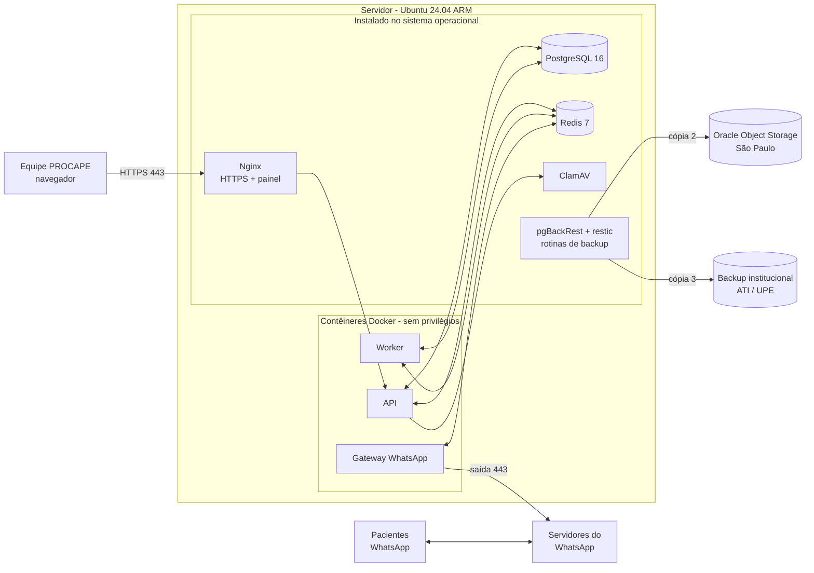

# Documento de Necessidades Técnicas
## PROCAPE – Saúde Digital: Bot de WhatsApp + Plataforma de Gestão

**Destinatários:** ATI-PE e setor de TI/Infraestrutura da UPE
**Responsável técnico (desenvolvimento e implantação):** Thompson Cysneiros
**Área solicitante:** NUTES / Saúde Digital – PROCAPE
**Situação:** planejamento (sistema ainda não implantado)

Documentos de referência (mesma pasta): `REQUISITOS.md`, `ARQUITETURA.md`,
`BANCO_DE_DADOS.md`, `MENSAGENS.md` e **`PLANO_PROTECAO_DADOS.md`** (plano
de segurança e proteção de dados – LGPD).

---

## 1. Resumo

O PROCAPE vai hospedar um sistema com dois componentes:

1. **Bot de WhatsApp** – envia confirmações, lembretes e links de
   teleconsulta e faz a triagem inicial das mensagens dos pacientes.
2. **Plataforma de gestão (painel web)** – usada pela equipe da Saúde
   Digital para cadastrar pacientes, agendar, atender pelo chat e
   acompanhar a agenda.

O sistema trata **dados pessoais de saúde** (dados sensíveis – LGPD, art. 5º,
II). Todas as decisões de infraestrutura abaixo seguem o
`PLANO_PROTECAO_DADOS.md`.

### Estratégia de hospedagem
| Fase | Onde | Situação |
|---|---|---|
| **1. Início** | **Oracle Cloud – Always Free (Free Tier)**, região **Brasil (São Paulo)** | Definido |
| **2. Migração (se autorizada)** | Servidor disponibilizado pela **ATI-PE / UPE** | Depende de autorização da ATI |

O modelo de produção (seção 5) foi escolhido para que a migração da fase 1
para a fase 2 seja simples e sem perda de dados.

### O que solicitamos à ATI / TI da UPE
| # | Pedido | Seção |
|---|---|---|
| 1 | **Domínio** `saudedigitalprocape.pe.gov.br` (ou outro com "saudedigital" ou "procape") apontando para o servidor | 4 |
| 2 | **Destino de backup institucional** (3ª cópia, fora da Oracle) | 7 |
| 3 | **Relay SMTP** institucional para e-mails do sistema | 4.4 |
| 4 | Avaliar a **migração** para servidor da ATI/UPE (especificação na seção 3) | 3 |
| 5 | **Opcional:** acesso à **API oficial do WhatsApp** (conta empresarial verificada do Governo/UPE) – elimina o risco de bloqueio do número | 6.2 |
| 6 | Indicação do **encarregado de dados (DPO)** para validar o plano LGPD | `PLANO_PROTECAO_DADOS.md` |

---

## 2. Visão geral da solução

---

## 3. Servidor

### 3.1 Volume esperado
| Item | Estimativa |
|---|---|
| Usuários da plataforma | até 15 cadastrados, até 5 simultâneos |
| Pacientes ativos | algumas centenas por ano |
| Mensagens de WhatsApp | até algumas centenas por dia |
| Banco de dados | < 5 GB nos primeiros anos |
| Anexos | até ~20 GB (apagados 90 dias após a consulta) |
| Funcionamento | bot 24h/7 dias; equipe seg–sex, 8h–17h |

### 3.2 Fase 1 – Oracle Cloud Always Free

| Recurso | Configuração |
|---|---|
| Instância | VM.Standard.A1.Flex (**ARM/Ampere**) – **4 OCPU, 24 GB RAM** |
| Armazenamento | **200 GB** de block volume (divisão na 3.4) |
| Sistema operacional | Ubuntu Server 24.04 LTS (aarch64) |
| Região | **sa-saopaulo-1 (São Paulo)** – dados no Brasil |
| IP | IP público **reservado** (fixo) |
| Object Storage | 20 GB (Always Free) – cópia 2 do backup |
| Backups de volume | 5 backups de volume (Always Free) – snapshot semanal |
| Rede | VCN privada, **Security List / NSG** liberando só 443 e 80 (e 22 só para IPs autorizados) |

O sistema usa uma fração dos recursos (estimativa: < 1 OCPU e < 4 GB de RAM
em uso normal); a sobra garante folga e permite rodar a **homologação** na
mesma conta, em instância separada, se necessário.

**Cuidados específicos da Oracle Free Tier** (e como tratamos):

| Risco | Mitigação |
|---|---|
| Instância Always Free **ociosa pode ser recuperada** pela Oracle | Converter a conta para **Pay As You Go** mantendo só recursos Always Free (sem custo) e **alerta de orçamento em R$ 0**; isso remove a recuperação por ociosidade |
| Sem SLA contratual | Backup em 3 cópias, sendo uma **fora da Oracle** (seção 7) e plano de migração para a ATI |
| Suspensão/perda da conta | Conta **institucional** (e-mail do NUTES/UPE, não pessoal), **2 administradores**, MFA no console; 3ª cópia do backup fora da Oracle |
| Falta de capacidade ARM na região ao recriar a VM | Imagem/volume preservados por backup de volume; scripts de provisionamento para recriar em qualquer servidor |
| Responsabilidade LGPD sobre o provedor | Oracle atua como **operadora**; aceitar o Data Processing Agreement em nome da instituição (ver plano LGPD) |

### 3.3 Fase 2 – servidor ATI/UPE (especificação equivalente)
| Recurso | Mínimo | Recomendado |
|---|---|---|
| vCPU | 2 | 4 |
| RAM | 4 GB | 8 GB |
| Disco | 120 GB SSD | 200 GB SSD (mesma divisão da 3.4) |
| SO | Ubuntu Server 24.04 LTS (x86_64 ou ARM) | idem |
| Criptografia de disco | Sim | Sim |
| Snapshots | Diário, 7 dias | idem |

A aplicação roda em ARM (Oracle) e em x86 (ATI) sem alteração: as imagens são
geradas para as duas arquiteturas e o restante é instalado pelo mesmo script
de provisionamento.

### 3.4 Divisão dos 200 GB
| Volume | Tamanho | Conteúdo | Criptografia |
|---|---|---|---|
| Boot | 50 GB | Sistema operacional, Docker, logs | Criptografia da Oracle |
| **Dados** | 100 GB | PostgreSQL, Redis (persistência), anexos | **LUKS** (chave fora do volume) + criptografia da Oracle |
| **Backup local** | 50 GB | Repositório pgBackRest e restic (cópia 1) | **LUKS** + criptografia própria dos backups |

Separar o backup em outro volume protege contra corrupção ou exclusão
acidental do volume de dados. Alertas em 80% de uso de cada volume.

---

## 4. Rede, domínio e e-mail

### 4.1 Domínio
- **Preferido:** `saudedigitalprocape.pe.gov.br`.
  Alternativas aceitas: qualquer nome com "saudedigital" ou "procape" sob
  `pe.gov.br` ou `upe.br`.
- **Pedido à ATI:** registro **DNS tipo A** apontando para o IP reservado da
  Oracle (e, após a migração, para o IP do servidor da ATI).
- **Certificado:** Let's Encrypt com renovação automática (ou certificado
  institucional, se a ATI preferir).
- TLS 1.2+ (preferencialmente 1.3) e HSTS.

### 4.2 Entrada (Security List da Oracle + firewall do servidor)
| Porta | Origem | Finalidade |
|---|---|---|
| 443 | Internet | Painel web e API (HTTPS) |
| 80 | Internet | Só redirecionamento para 443 e validação do certificado |
| 22 | **Somente IPs autorizados** | Administração (SSH com chave) |

Banco, Redis e serviços internos **não** ficam expostos.

### 4.3 Saída
| Destino | Porta | Finalidade |
|---|---|---|
| `web.whatsapp.com`, `*.whatsapp.net` | 443 | Conexão do bot |
| Repositórios Ubuntu | 80/443 | Atualizações de segurança |
| `ghcr.io` / `registry-1.docker.io` | 443 | Imagens da aplicação |
| `github.com` | 443 | Código-fonte e implantação |
| `acme-v02.api.letsencrypt.org` | 443 | Certificado |
| Oracle Object Storage (São Paulo) | 443 | Backup – cópia 2 |
| Destino de backup da ATI/UPE | conforme solução | Backup – cópia 3 |
| Relay SMTP | 587 | E-mails do sistema |
| NTP | 123/UDP | Hora correta (lembretes dependem disso) |

### 4.4 E-mail (SMTP)
Para redefinição de senha, recuperação de 2FA e alertas técnicos. Pedimos
**relay SMTP institucional** com remetente como
`nao-responda@saudedigitalprocape.pe.gov.br`. Os e-mails **nunca** contêm
dados de pacientes.

---

## 5. Modelo de produção – Docker ou instalação direta?

### 5.1 Avaliação
| Critério | Tudo em Docker | Tudo instalado direto | **Híbrido (escolhido)** |
|---|---|---|---|
| Atualizações de segurança | Imagens precisam ser reconstruídas; patches do SO não chegam aos contêineres | `unattended-upgrades` cobre tudo automaticamente | Dados e serviços expostos recebem patch automático do SO; app reconstruída semanalmente |
| Firewall | Docker publica portas **contornando o ufw** (risco comum de exposição acidental do banco) | Firewall funciona como esperado | Nenhuma porta de contêiner publicada para fora (só `127.0.0.1`) |
| Banco e backup | Backup/PITR dentro de contêiner é mais frágil | pgBackRest nativo, PITR, ferramentas maduras | **Banco nativo** |
| Isolamento da aplicação | Bom | Processos dividem o mesmo ambiente | **App isolada** em contêiner sem privilégios |
| Migração Oracle (ARM) → ATI | Fácil | Precisa reinstalar tudo à mão | Script de provisionamento + imagens multi-arquitetura |
| Auditoria pela ATI | Exige conhecer Docker | Familiar para qualquer equipe de infra | Camada de dados familiar; app documentada |
| Rollback de versão | Fácil (tag da imagem) | Manual | Fácil (tag da imagem) |

### 5.2 Decisão: modelo híbrido
- **Instalados no sistema operacional (pacotes oficiais, atualização
  automática):** Nginx, PostgreSQL 16, Redis 7, ClamAV, Certbot,
  pgBackRest, restic, ufw, fail2ban.
- **Em contêineres Docker:** apenas a aplicação (API, worker e gateway do
  WhatsApp), com:
  - usuário **não root** dentro do contêiner, sistema de arquivos **somente
    leitura**, sem capacidades extras (`cap_drop: ALL`,
    `no-new-privileges`);
  - **nenhuma porta publicada** para a internet – a API escuta só em
    `127.0.0.1` e o Nginx do host faz o proxy;
  - acesso ao banco/Redis só pela rede interna do Docker, liberada no
    `pg_hba.conf` e no Redis apenas para essa sub-rede, com senha;
  - imagens mínimas, versionadas por tag, **reconstruídas semanalmente** e
    verificadas contra vulnerabilidades antes da implantação;
  - o socket do Docker **não** é montado em nenhum contêiner e só o
    administrador pertence ao grupo `docker`.
- O painel (React) é publicado como arquivos estáticos servidos pelo Nginx
  do host.
- Todo o provisionamento do servidor fica em **script versionado** (Ansible),
  usado igualmente na Oracle e na ATI.

Resultado: os **dados** ficam na camada mais simples de proteger, atualizar e
auditar, e a **aplicação** mantém o isolamento e a portabilidade do Docker.

---

## 6. Aplicação

### 6.1 Tecnologias
| Camada | Tecnologia |
|---|---|
| Linguagem | TypeScript (Node.js 22 LTS) |
| API | NestJS (REST + WebSocket para tempo real) |
| Banco | PostgreSQL 16 (migrações versionadas – Prisma) |
| Filas/agendamentos | Redis 7 + BullMQ |
| Painel | React (estático) |
| WhatsApp | Baileys (fase 1) ou API oficial (6.2) |
| Código-fonte | Repositório Git privado (GitHub), **sem dados pessoais** |

Verificação de saúde: `GET /health` (API, banco, Redis, conexão do WhatsApp).

### 6.2 Canal WhatsApp
**Fase 1 – Baileys.** Conexão do servidor como "aparelho conectado" a um
número institucional. Sem custo e sem aprovação de mensagens, mas **não é
oficial**: há risco de **bloqueio do número** e de interrupções quando o
WhatsApp muda o protocolo.

- **Chip e celular:** responsabilidade do **NUTES / Saúde Digital** – chip
  institucional dedicado e celular com WhatsApp Business, ligado na tomada e
  com internet, guardado em local seguro (regras de segurança do aparelho no
  plano LGPD, seção 9.6).
- Mitigações: envio em lote com intervalos, monitoramento da conexão,
  credenciais da conexão criptografadas.

**Opção oficial (recomendada se a ATI viabilizar).** Se a ATI/UPE fornecer
acesso à **API oficial do WhatsApp (WhatsApp Business Platform)** com conta
empresarial **verificada** pela Meta – isto é, o **token de acesso** e o
identificador do número –, o sistema passa a usar a API oficial e o risco de
bloqueio/perda do número deixa de existir. O sistema já foi desenhado para
essa troca (só muda o módulo de envio). Implicações: mensagens iniciadas pelo
PROCAPE passam a exigir modelos aprovados pela Meta e há cobrança por
mensagem conforme a tabela da Meta.

> Observação: o que elimina o risco é o uso da **API oficial** com a conta
> empresarial verificada; apenas o selo de verificação, sem a API, não muda
> o risco do Baileys.

---

## 7. Backup (desenhado para a LGPD)

### 7.1 Estratégia 3-2-1
| Cópia | Onde | O quê / como | Frequência | Retenção |
|---|---|---|---|---|
| **1 – Local** | Volume de backup separado (LUKS) | **pgBackRest**: completo semanal, diferencial diário e **WAL contínuo** (recuperação até minutos antes de uma falha). **restic** para anexos | Contínuo / diário | 14 dias |
| **2 – Fora do servidor** | **Oracle Object Storage, São Paulo**, bucket privado | Mesmo conteúdo, **criptografado no servidor antes do envio** (AES-256) | Diário | Diários 35 dias + mensais 6 meses |
| **3 – Fora da Oracle** | **Storage institucional ATI/UPE** (a definir) | Cópia criptografada via restic/SFTP | Semanal | 35 dias + mensais 6 meses |
| Complementar | Backup de volume da Oracle | Snapshot do volume de dados | Semanal | 4 semanas (limite Always Free: 5) |

| Métrica | Meta |
|---|---|
| RPO (perda máxima de dados) | **≤ 15 minutos** (WAL contínuo para a cópia 1 e 2) |
| RTO (tempo para voltar) | **≤ 4 horas** em horário comercial |
| Teste de restauração | **Mensal**, em ambiente isolado |
| Verificação de integridade | Semanal (`pgbackrest verify`, `restic check`) com alerta |

Capacidade: banco comprimido (< 2 GB) + anexos dos últimos 90 dias cabem
nos 20 GB do Object Storage gratuito; alerta em 80% da cota.

### 7.2 Regras LGPD aplicadas ao backup
1. **Criptografia na origem** (AES-256) antes de sair do servidor; o
   provedor de armazenamento nunca vê os dados (LGPD art. 46).
2. **Chaves separadas dos backups:** guardadas em cofre de senhas, com cópia
   lacrada sob guarda da Supervisão do NUTES; rotação anual; sem a chave os
   backups são ilegíveis.
3. **Dados no Brasil:** Oracle São Paulo e storage da ATI/UPE – sem
   transferência internacional (art. 33).
4. **Retenção curta e definida:** nenhum backup é guardado por mais de
   **6 meses** (necessidade – art. 6º, III).
5. **Eliminação também chega ao backup:** dados eliminados ou anonimizados
   deixam de existir em todas as cópias em, no máximo, 6 meses (expiração
   automática). Até lá ficam inacessíveis para uso.
6. **Registro de eliminações:** o sistema mantém uma lista (sem dados
   pessoais, só identificadores internos e datas) das eliminações e
   anonimizações. **Após qualquer restauração, essa lista é reaplicada**
   antes de liberar o sistema – nada que foi eliminado "volta".
7. **Acesso mínimo:** só o responsável técnico e a Supervisão podem
   restaurar; credenciais do bucket com permissão restrita ao uso de backup;
   toda restauração é registrada (quem, quando, motivo).
8. **Proteção contra ransomware:** regra de retenção (imutabilidade) de
   35 dias no bucket – cópias não podem ser apagadas antes do prazo nem por
   um invasor.
9. **Testes sem expor dados:** restaurações de teste em ambiente isolado,
   destruído ao final; **backups nunca alimentam o ambiente de testes**.
10. **Descarte seguro:** ao fim da retenção, a expiração apaga os objetos; ao
    encerrar a Oracle (migração), buckets, volumes e backups são excluídos e
    a exclusão é registrada (plano LGPD, seção 12).

---

## 8. Segurança (resumo – detalhes no plano LGPD)

**Servidor:** atualizações automáticas; SSH só com chave, sem root, só IPs
autorizados; ufw + Security List da Oracle; fail2ban; volumes LUKS; NTP;
ClamAV nos anexos; logs centralizados por 90 dias sem dados sensíveis.

**Aplicação:** HTTPS obrigatório; senhas com argon2; bloqueio após 5
tentativas; sessão de 30 min; **2FA obrigatório** para Administrador e
Supervisão; 4 níveis de acesso validados no servidor; auditoria de acessos e
alterações; segredos fora do código; exportação só de dados cadastrais.

**Conta Oracle:** institucional, MFA, 2 administradores, alerta de
orçamento, registro de auditoria da Oracle ativado.

---

## 9. Acessos e implantação
| Acesso | Para quem | Finalidade |
|---|---|---|
| Console Oracle (MFA) | Responsável técnico + 1 administrador do NUTES | Gerenciar a infraestrutura |
| SSH (chave) | Responsável técnico | Instalar, implantar, manter |
| DNS (via ATI) | ATI | Apontar o domínio |
| SMTP | Aplicação | E-mails do sistema |
| Storage de backup ATI/UPE | Rotina de backup | Cópia 3 |

Novas versões: testadas em homologação com **dados fictícios** e
implantadas **fora do horário de atendimento**.

---

## 10. Monitoramento
| Item | Proposta |
|---|---|
| Disponibilidade alvo | 99% |
| Verificação | `GET /health` a cada 5 min (Uptime Kuma ou ferramenta da ATI) |
| Alertas por e-mail | Sistema fora do ar, WhatsApp desconectado, backup ou verificação com falha, volume > 80%, certificado a vencer |
| Logs | 90 dias, sem dados sensíveis em texto aberto |

---

## 11. Responsabilidades

| Atividade | ATI / TI UPE | Responsável técnico | NUTES / Saúde Digital | DPO |
|---|---|---|---|---|
| **Desenvolvimento do sistema** (código, testes, correções, documentação técnica) | – | **Executa** | Valida funcionalidades | – |
| Conta e infraestrutura Oracle (fase 1) | – | **Executa** | Titular da conta (e-mail institucional) | – |
| Servidor ATI/UPE (fase 2) | **Executa** | Apoia | – | – |
| Domínio e DNS | **Executa** | Solicita | – | – |
| Sistema operacional e patches | Fase 2: executa ou compartilha | Fase 1: **executa** | – | – |
| Implantação e atualização da aplicação | Acompanha | **Executa** | Valida | – |
| Rotina de backup e testes de restauração | Fornece a cópia 3 | **Executa** | Guarda cópia da chave | – |
| **Chip e celular do WhatsApp** | – | Configura a conexão | **Fornece, guarda e mantém** | – |
| API oficial do WhatsApp (opcional) | **Viabiliza** a conta/token | Integra | – | – |
| Usuários e permissões do sistema | – | Suporte | **Executa (Supervisão)** | – |
| Atendimento aos direitos dos titulares | – | Suporte técnico | **Executa** | **Supervisiona** |
| Validação LGPD, RIPD e aviso de privacidade | Apoia | Apoia | Apoia | **Executa** |
| Resposta a incidentes | Infra da fase 2 | **Executa** (técnico) | Comunica | **Coordena** (ANPD/titulares) |

---

## 12. Perguntas para a ATI / TI da UPE
1. Podemos usar `saudedigitalprocape.pe.gov.br`? Quem cria o registro DNS?
2. A ATI/UPE disponibiliza **storage** para a 3ª cópia do backup?
3. Há **relay SMTP** para sistemas?
4. A ATI autoriza e oferece servidor para a **fase 2**? Quais requisitos
   (VPN, termo de responsabilidade para acesso externo, janela de manutenção)?
5. A ATI/UPE consegue viabilizar a **API oficial do WhatsApp** com conta
   empresarial verificada?
6. Existe ferramenta de **monitoramento** institucional?
7. Quem é o **encarregado de dados (DPO)** da UPE/PROCAPE?

---

## 13. Cronograma de dependências
| Etapa | Depende de |
|---|---|
| Desenvolvimento e testes (dados fictícios) | – |
| Homologação na Oracle | Conta Oracle institucional, domínio provisório ou definitivo |
| Produção na Oracle | Domínio, certificado, backup (cópias 1 e 2), SMTP, chip/celular, validação do DPO, RIPD |
| Cópia 3 do backup | Storage da ATI/UPE |
| Migração para a ATI (fase 2) | Autorização e servidor da ATI |
