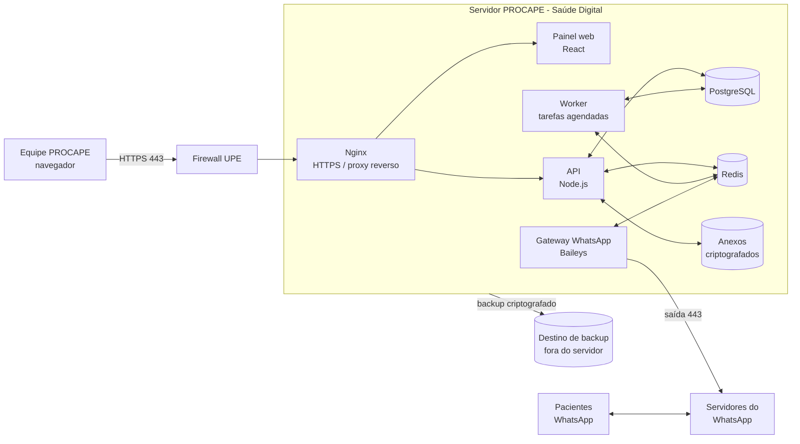

# Documento de Necessidades Técnicas
## PROCAPE – Saúde Digital: Bot de WhatsApp + Plataforma de Gestão

**Destinatário:** Setor de TI e Infraestrutura da UPE
**Responsável técnico pelo desenvolvimento:** Thompson Cysneiros
**Área solicitante:** Saúde Digital – PROCAPE
**Situação:** planejamento (sistema ainda não implantado)

Documentos de referência do projeto (mesma pasta): `REQUISITOS.md`,
`ARQUITETURA.md`, `BANCO_DE_DADOS.md`, `MENSAGENS.md`.

---

## 1. Resumo para a TI

O PROCAPE precisa hospedar um sistema web com dois componentes:

1. **Bot de WhatsApp** que envia confirmações, lembretes e links de
   teleconsulta aos pacientes e faz a triagem inicial das mensagens recebidas.
2. **Plataforma de gestão (painel web)** usada pela equipe da Saúde Digital
   para cadastrar pacientes, agendar teleconsultas, atender pelo chat e
   acompanhar a agenda.

O sistema trata **dados pessoais de saúde** (LGPD – dados sensíveis). Por
isso, a hospedagem deve ser **institucional (UPE/PROCAPE)**, com dados no
Brasil, acesso restrito e cópias de segurança.

**O que solicitamos à TI, em resumo:**

| # | Item | Seção |
|---|---|---|
| 1 | 1 servidor virtual (VM/VPS) Linux para produção | 3 |
| 2 | 1 servidor virtual menor para homologação (testes) – desejável | 3 |
| 3 | Subdomínio institucional + certificado HTTPS | 4 |
| 4 | Regras de firewall (entrada 443/80; saída para WhatsApp e atualizações) | 4 |
| 5 | Acesso SSH administrativo para o responsável técnico | 9 |
| 6 | Destino para backup externo ao servidor | 6 |
| 7 | Relay SMTP institucional (e-mails de alerta e redefinição de senha) | 4.4 |
| 8 | Apoio na validação de segurança/LGPD com o encarregado (DPO) | 7 e 8 |

---

## 2. Visão geral da solução

- Todos os componentes rodam em **contêineres Docker** no mesmo servidor,
  orquestrados por **Docker Compose**.
- O único acesso de entrada pela internet é o **HTTPS (443)** do painel.
- O WhatsApp funciona por **conexão de saída** do servidor (não exige porta de
  entrada).

---

## 3. Servidor

### 3.1 Volume esperado (para dimensionamento)

| Item | Estimativa |
|---|---|
| Usuários da plataforma | até 15 cadastrados, até 5 simultâneos |
| Pacientes ativos | algumas centenas por ano (≈12 novos/semana no pré-cateterismo + pós-angioplastia + fibrilação atrial) |
| Mensagens de WhatsApp | até algumas centenas por dia |
| Banco de dados | < 5 GB nos primeiros anos |
| Anexos (exames/documentos) | até ~20 GB (apagados 90 dias após a consulta) |
| Funcionamento | bot 24h/7 dias; equipe em horário comercial (seg–sex, 8h–17h) |

### 3.2 Especificação

| Recurso | Produção – mínimo | Produção – recomendado | Homologação |
|---|---|---|---|
| vCPU | 2 | 4 | 2 |
| Memória RAM | 4 GB | 8 GB | 4 GB |
| Disco | 80 GB SSD | 120 GB SSD | 40 GB SSD |
| Sistema operacional | Ubuntu Server 24.04 LTS 64 bits | idem | idem |
| Rede | IP fixo (público ou atrás de NAT/proxy da UPE) | idem | idem |
| Localização | **Datacenter no Brasil** (UPE ou nuvem com região Brasil) | idem | idem |
| Criptografia do disco | Desejável (LUKS ou nativa do hipervisor/nuvem) | **Sim** | Opcional |
| Snapshots da VM | Desejável | Diário, retenção 7 dias | – |

Observações:
- **Homologação** é usada para testes com **dados fictícios** antes de cada
  atualização. Se não for possível, os testes são feitos em ambiente do
  desenvolvedor, sem dados reais.
- O sistema não exige licenças pagas: todo o software é de código aberto.

### 3.3 Software no servidor

A TI entrega o sistema operacional instalado e atualizado; a instalação do
restante pode ser feita pelo responsável técnico.

| Software | Versão | Uso |
|---|---|---|
| Ubuntu Server | 24.04 LTS | Sistema operacional |
| Docker Engine + Docker Compose v2 | estáveis atuais | Execução dos contêineres |
| Nginx (contêiner) | estável | Proxy reverso e HTTPS |
| Node.js (contêiner) | 22 LTS | API, worker e gateway do WhatsApp |
| PostgreSQL (contêiner) | 16 | Banco de dados |
| Redis (contêiner) | 7 | Filas e tarefas agendadas |
| Certbot / ACME | – | Renovação automática do certificado (se não for usado certificado institucional) |
| ClamAV (contêiner) | – | Verificação antivírus dos anexos enviados pelos pacientes |

---

## 4. Rede, domínio e e-mail

### 4.1 Domínio e certificado
- **Subdomínio institucional** para o painel, por exemplo
  `saudedigital.procape.<domínio da UPE>` (nome a definir com a TI),
  com registro DNS tipo A apontando para o servidor.
- **Certificado HTTPS**: institucional (fornecido pela TI) **ou** emissão
  automática Let's Encrypt (nesse caso, a porta 80 precisa estar aberta para
  validação e redirecionamento).
- TLS 1.2 ou superior; HSTS habilitado.

### 4.2 Firewall – entrada

| Porta | Protocolo | Origem | Finalidade |
|---|---|---|---|
| 443 | TCP (HTTPS) | Internet (ou só rede UPE + VPN, se a TI preferir) | Painel web e API |
| 80 | TCP (HTTP) | Internet | Só redirecionamento para 443 e validação do certificado |
| 22 | TCP (SSH) | **Somente IPs autorizados ou VPN da UPE** | Administração do servidor |

Nenhuma outra porta (banco, Redis etc.) fica exposta; todas ficam internas aos
contêineres.

> Decisão para a TI/Saúde Digital: o painel ficará acessível **pela
> internet** (permite trabalho remoto da equipe) ou **somente pela rede da
> UPE/VPN**? O sistema funciona nos dois cenários; o login tem senha forte,
> bloqueio após tentativas e 2FA obrigatório para administradores.

### 4.3 Firewall – saída

| Destino | Porta | Finalidade |
|---|---|---|
| Servidores do WhatsApp (`web.whatsapp.com`, `*.whatsapp.net`) | 443 (WebSocket/HTTPS) | Conexão do bot |
| Repositórios do Ubuntu | 80/443 | Atualizações de segurança |
| Registros de contêiner (`registry-1.docker.io`, `ghcr.io`) | 443 | Download das imagens |
| Registro npm (`registry.npmjs.org`) | 443 | Build da aplicação |
| GitHub (`github.com`) | 443 | Código-fonte e implantação |
| Let's Encrypt (`acme-v02.api.letsencrypt.org`) | 443 | Certificado (se usado) |
| Servidor NTP | 123/UDP | Hora correta (lembretes e agendamentos dependem disso) |
| Destino de backup | conforme solução | Cópia de segurança |
| Relay SMTP institucional | 25/587 | E-mails do sistema |

Se a saída da UPE passa por **proxy**, ele precisa suportar **WebSocket
(conexões longas)** para o WhatsApp e para o painel em tempo real.

### 4.4 E-mail (SMTP)
Necessário para: redefinição de senha dos usuários, recuperação de 2FA e
alertas técnicos (WhatsApp desconectado, falha de backup, disco cheio).
Solicitamos **acesso a um relay SMTP institucional** e um remetente, por
exemplo `nao-responda.saudedigital@<domínio>`.

---

## 5. Aplicação (visão técnica)

| Camada | Tecnologia |
|---|---|
| Linguagem | TypeScript (Node.js 22 LTS) |
| API | NestJS (REST + WebSocket/Socket.IO para tempo real) |
| Banco | PostgreSQL 16, migrações versionadas (Prisma) |
| Filas/agendamentos | Redis + BullMQ (lembretes, envio de links, encerramento de conversas) |
| Painel web | React (arquivos estáticos servidos pelo Nginx) |
| WhatsApp | Biblioteca **Baileys** (conexão como "aparelho conectado", igual ao WhatsApp Web) |
| Implantação | Docker Compose; configuração por variáveis de ambiente |
| Código-fonte | Repositório Git privado no GitHub |

Processos em execução (contêineres): `nginx`, `web`, `api`, `worker`,
`whatsapp-gateway`, `postgres`, `redis`, `clamav`.

Endpoint de saúde para monitoramento: `GET /health` (retorna estado da API,
banco, Redis e conexão do WhatsApp).

### 5.1 Canal WhatsApp – Baileys
A Saúde Digital optou pelo **Baileys** (sem custo por mensagem e sem
aprovação prévia de mensagens). Pontos que a TI deve conhecer:

- **Não é a API oficial da Meta.** Existe risco de **bloqueio do número**
  pelo WhatsApp e de interrupção temporária quando o WhatsApp muda seu
  protocolo. Mitigações previstas: número institucional dedicado, envio em
  lote com intervalos, monitoramento da conexão e possibilidade de migrar
  para a API oficial trocando só o módulo de envio.
- **Necessário (fornecido pelo PROCAPE):** um **chip institucional dedicado**
  e um **celular simples** com WhatsApp Business, mantido **ligado na tomada e
  com internet** (Wi-Fi da UPE ou dados móveis). O servidor se conecta a esse
  número como aparelho conectado.
- As credenciais da conexão equivalem à senha do número: ficam
  **criptografadas** no banco e só Admin/Supervisão podem reconectar.

---

## 6. Banco de dados, anexos e backup

| Item | Necessidade |
|---|---|
| Backup do banco | `pg_dump` **diário**, criptografado antes de sair do servidor |
| Backup dos anexos | Diário, criptografado |
| Destino | **Fora do servidor**: servidor de backup da UPE, storage institucional ou armazenamento S3 compatível no Brasil (a definir com a TI) |
| Retenção | 30 dias (diários) |
| Teste de restauração | Mensal, em homologação |
| RPO (perda máxima de dados) | 24 horas |
| RTO (tempo para voltar) | 4 horas em horário comercial |
| Snapshots da VM | Diário, 7 dias (complementar, se o hipervisor permitir) |

Retenção dos dados no sistema (política LGPD do projeto):
- cadastro e conversas: até 5 anos após o último contato, depois
  **anonimização** automática;
- anexos (exames/documentos): apagados **90 dias após a consulta**;
- auditoria de acessos: 5 anos.

---

## 7. Segurança

### 7.1 Servidor (responsabilidade compartilhada TI + responsável técnico)
- Atualizações automáticas de segurança do Ubuntu (`unattended-upgrades`).
- SSH **somente com chave**, sem login de root, porta restrita a IPs/VPN.
- Firewall local (`ufw`) além do firewall de borda da UPE.
- `fail2ban` para tentativas de acesso SSH.
- Disco criptografado (recomendado).
- Sincronização de horário (NTP) ativa.
- Antivírus nos anexos recebidos (ClamAV).

### 7.2 Aplicação
- HTTPS obrigatório (TLS 1.2+, HSTS).
- Senhas com hash forte (argon2); bloqueio após 5 tentativas; sessão expira
  após 30 min sem uso.
- **2FA obrigatório** para Administrador e Supervisão.
- Controle de acesso por **4 níveis** (Administrador, Supervisão, Atendente,
  Equipe específica), validado no servidor.
- **Auditoria** de visualização e alteração de dados de pacientes,
  exportações e mudanças de configuração.
- Segredos (senhas do banco, chaves de criptografia) em arquivos com
  permissão restrita no servidor, **nunca** no código-fonte.
- Banco, Redis e serviços internos sem exposição à rede.
- Limite de requisições (rate limiting) no login e na API.
- Exportação restrita a **dados cadastrais** e apenas para Admin/Supervisão.

---

## 8. LGPD

| Tema | Como o projeto atende |
|---|---|
| Natureza dos dados | Dados pessoais e de saúde (sensíveis) |
| Base legal | Tutela da saúde (LGPD, art. 11, II, "f") |
| Minimização | Cadastro só com nome, CPF, prontuário (opcional), telefones e data de nascimento |
| Localização | Servidor e backups **no Brasil** |
| Acesso | Por perfil e equipe, com 2FA para administradores e auditoria |
| Retenção | Seção 6 (anonimização após 5 anos; anexos 90 dias) |
| Direitos do titular | Pedido pelo WhatsApp ("meus dados") → Supervisão; exportação e anonimização por paciente |
| Ambiente de testes | Somente dados fictícios |
| Incidentes | Registro e comunicação imediata ao encarregado (DPO) |
| Não é prontuário | Informação clínica relevante é registrada no prontuário oficial do hospital |

**Solicitação:** validação do aviso de privacidade e desta seção pelo
**encarregado de dados (DPO)** da UPE/PROCAPE antes da produção.

---

## 9. Acessos necessários para a implantação

| Acesso | Para quem | Finalidade |
|---|---|---|
| SSH com sudo (chave pública) nos servidores | Responsável técnico (Thompson) | Instalar, implantar e manter a aplicação |
| Ajuste de DNS (via chamado) | TI | Apontar o subdomínio |
| Relay SMTP | Aplicação | E-mails do sistema |
| Destino de backup (credencial de escrita) | Aplicação | Envio dos backups |
| Saída para os destinos da seção 4.3 | Servidor | Funcionamento e atualizações |

Implantação de novas versões: feita pelo responsável técnico via Docker
Compose, **fora do horário de atendimento** (após 17h ou fim de semana),
sempre testada antes em homologação.

---

## 10. Monitoramento e disponibilidade

| Item | Proposta |
|---|---|
| Disponibilidade alvo | 99% (o bot opera 24h; a equipe, em horário comercial) |
| Verificação de saúde | Monitoramento do `GET /health` a cada 5 min (ferramenta da UPE, se houver, ou Uptime Kuma no próprio servidor) |
| Alertas | E-mail para responsável técnico e Supervisão: sistema fora do ar, WhatsApp desconectado, backup com falha, disco acima de 80% |
| Logs | Logs da aplicação e do Nginx retidos por 90 dias, sem dados sensíveis em texto aberto |
| Janela de manutenção | Seg–sex após 17h ou fins de semana |

---

## 11. Responsabilidades (proposta)

| Atividade | TI/Infra UPE | Responsável técnico | Saúde Digital (PROCAPE) | DPO |
|---|---|---|---|---|
| Provisionar servidor, rede, DNS, firewall | **Executa** | Apoia | – | – |
| Sistema operacional e patches de segurança | **Executa** ou compartilha | Apoia | – | – |
| Instalação e atualização da aplicação | Acompanha | **Executa** | Valida | – |
| Backup – destino e infraestrutura | **Executa** | Configura rotina | – | – |
| Teste de restauração | Apoia | **Executa** | – | – |
| Chip e celular do WhatsApp | – | Configura conexão | **Fornece e mantém** | – |
| Usuários e permissões do sistema | – | Suporte | **Executa (Supervisão)** | – |
| Validação LGPD / aviso de privacidade | – | Apoia | Apoia | **Executa** |
| Resposta a incidentes | **Executa** (infra) | **Executa** (aplicação) | Comunica | **Coordena** |

---

## 12. Perguntas para a TI da UPE

1. A UPE disponibiliza **VM no datacenter próprio** ou a contratação será em
   **nuvem** (com região Brasil)? Há política institucional para isso?
2. O painel pode ser acessado **pela internet** ou deve ficar **restrito à
   rede da UPE/VPN**?
3. Qual **subdomínio** pode ser usado? A TI fornece **certificado** ou
   podemos usar Let's Encrypt?
4. A saída de internet passa por **proxy**? Ele suporta **WebSocket**?
5. Existe **servidor/storage de backup** institucional que possamos usar?
6. Há **relay SMTP** disponível para sistemas?
7. Existe ferramenta de **monitoramento** institucional (Zabbix, Grafana etc.)
   onde possamos cadastrar o `GET /health`?
8. Qual o procedimento para **acesso SSH** de um responsável técnico externo
   (VPN, termo de responsabilidade, chave)?
9. Há **política de patches**/janela de manutenção que devemos seguir?
10. Quem é o **encarregado de dados (DPO)** para a validação LGPD?

---

## 13. Cronograma de dependências

| Etapa | Depende de | Prazo desejado |
|---|---|---|
| Desenvolvimento e testes com dados fictícios | – (ambiente do desenvolvedor) | Em andamento |
| Homologação no servidor da UPE | Servidor de homologação, SSH, DNS | Antes dos testes com a equipe |
| Produção | Servidor de produção, certificado, backup, SMTP, chip/celular do WhatsApp, validação do DPO | Ao final dos testes (~20 dias após o início do desenvolvimento) |
